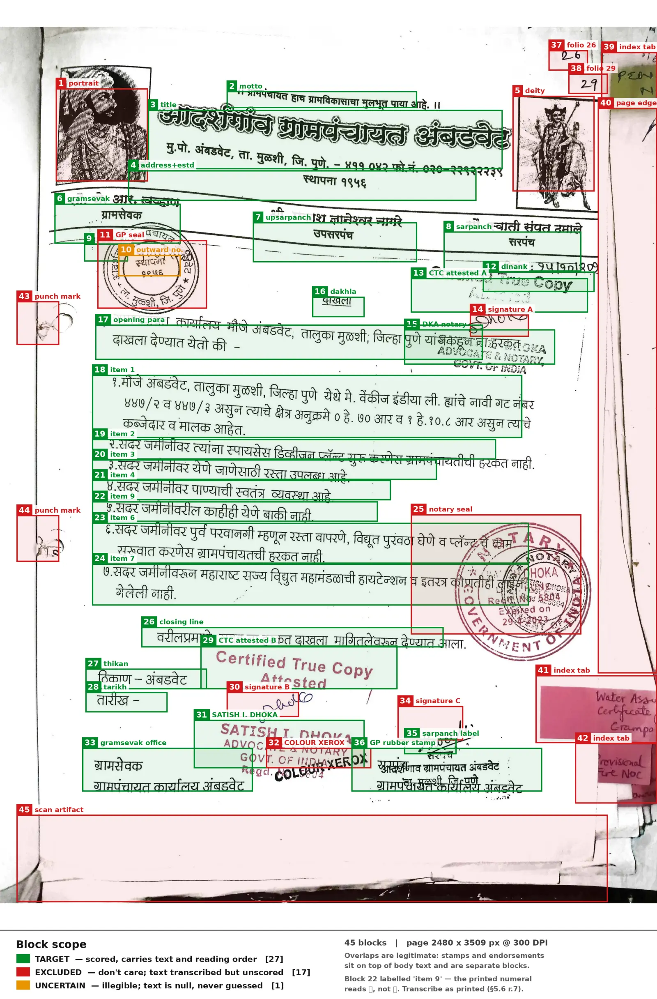

# Indian Government Document Benchmark
## Data Format, Annotation Guidelines, and Metrics Specification

**Version:** 0.9 (draft — not yet frozen)
**Status:** For pilot annotation and reference scorer implementation

**Changes since 0.8:** block segmentation substantially reworked after review against ten
further government pages — the amendment test added as the stated mental model with explicit
precedence (§6.3.1–6.3.2); the enumeration trigger removed and folded into spatial discontinuity
(§6.3.3); a paragraph-boundary trigger added; documentary role replaced by a closed list (§6.4);
the label/value and boilerplate/variable rules stated (§6.3.4, §6.3.7); presentation-is-not-
transcribed consolidated (§6.3.6). Table identification, the frame test for banner rows, leader
columns and merged cells added (§7.6–7.7). Strikethrough handling extended to table cells and
U+0336 explicitly rejected (§6.12, with a `struck` flag in §5.2). Orientation established before
reading order (§6.15). `IGDB-Score` added for leaderboard sorting (§16) and cost reporting added
(§17). Rotation added to stratification (§4.3); rectangular `poly` allowed (§5.5); diagnostic
interpretation guidance added (§2.2).

**Changes since 0.7:** block segmentation rules added as §6.3, with the six split triggers and a
fully segmented worked page; `reproduction_stamp` added to the `reason` vocabulary; column
banding clarified as local rather than page-wide (§6.14); §19 split into schema mechanics and a
full-page segmentation example. Sections §6.3–§6.14 renumbered to §6.4–§6.15.

**Changes since 0.6:** fixed the matching algorithm — split and merge recovery no longer require
a prior primary match, which had made matching 1:1 in practice and produced `textCER ≈ 2.0` on
pages whose only fault was segmentation granularity (§9.3); adjacency examined and deliberately
rejected as a filter, added as a diagnostic (§9.3.1); `merge_groups` added for multi-column
truncated paragraphs (§5.7); block match rate and non-contiguous group rate added to the
mandatory diagnostics (§2.2).

**Changes since 0.5:** mandatory degeneracy and distribution diagnostics added (§2.2) after
published Indic OCR results showed unbounded edit-distance metrics failing on VLM repetition
loops; ANLS correspondence stated (§2.3); script-difficulty framing added to stratification
(§4.3); contamination mitigations made concrete (§4.5, §18.4); submission manifest and prompt
disclosure required (§9.1.3); relation to prior work recorded (§17).

**Changes since 0.4:** TEDS implementation behaviour documented and confirmed (§12.2–12.3);
§18.1 closed as a result.

**Changes since 0.3:** annotation guidelines folded in as §6, adapted from the original rules
document with the internal conflicts resolved; corpus specification added as §4; multi-page
table handling removed (single-page corpus); `reason` promoted from free text to a controlled
vocabulary; `figure` blocks are now always `excluded`; data provenance recorded as §15.

---

## 1. Conventions

The key words **MUST**, **MUST NOT**, **SHOULD**, **SHOULD NOT**, and **MAY** are used as
defined in RFC 2119.

Any behaviour not specified in this document is a defect in this document, not a decision
left to the implementer. Two independent implementations of the scorer MUST produce
bit-identical results on the same reference set and prediction set.

---

## 2. Metric Suite

The benchmark publishes exactly six headline numbers. Nothing else appears on the leaderboard.

| # | Metric | Unit | Range | Direction | Covers |
|---|--------|------|-------|-----------|--------|
| 1 | `textCER_raw` | character error rate | 0 → ∞ | lower better | text blocks + table cells |
| 2 | `textCER_norm` | character error rate | 0 → ∞ | lower better | text blocks + table cells |
| 3 | `e2eNED_raw` | normalized edit distance | 0 → 1 | lower better | whole page, incl. reading order |
| 4 | `e2eNED_norm` | normalized edit distance | 0 → 1 | lower better | whole page, incl. reading order |
| 5 | `TEDS` | tree edit distance similarity | 0 → 1 | higher better | tables, structure + cell content |
| 6 | `TEDS-S` | tree edit distance similarity | 0 → 1 | higher better | tables, structure only |

`raw` and `norm` refer to the two text normalization profiles defined in §8. They differ
**only** in whitespace and invisible-character handling.

Not every submission format is scored on every metric — see §9.1 for the coverage matrix.

### 2.1 Naming rationale

`textCER` is a true micro-averaged character error rate (§10) and is therefore named CER.
`e2eNED` is length-normalized and bounded, and is therefore **not** named CER — publishing a
bounded normalized distance under a "CER" label invites incorrect comparison against CER
figures in the OCR literature.

### 2.2 Mandatory diagnostics

The six headline numbers are published alongside four diagnostics. These are not leaderboard
metrics and do not rank systems, but publishing results without them is misleading.

| Diagnostic | Definition |
|---|---|
| **Degeneracy rate** | Fraction of scored units (§10.2) whose per-unit normalized distance equals 1.0 *and* whose prediction is longer than 2× the reference. Detects repetition loops. |
| **Overflow rate** | Fraction of pages whose per-page `textCER` exceeds 1.0. |
| **Length ratio** | Median and 95th percentile of `len(S(pred)) / len(S(ref))` across pages. |
| **Per-page distribution** | Median and interquartile range of per-page `e2eNED`, not only the mean. |
| **Block match rate** | Fraction of reference target blocks that end up in a matched group (§9.3). |
| **Non-contiguous group rate** | Fraction of matched groups whose members are non-contiguous in `order`. A reading-order signal, not a penalty — see §9.3.1. |

**Reading the diagnostics together.** Low `e2eNED` with high `textCER` and a low block match
rate indicates a **localization** failure, not a recognition failure: the system read the text
correctly but placed its boxes badly, so matching failed and the residue rule of §10.1 charged
both sides. In that case `e2eNED` is the honest reading of the system's text quality. The two
metrics are deliberately built to differ this way — `textCER` depends on geometry, `e2eNED` does
not — and the pair is only diagnostic because of it.

**Block match rate is the matcher's own health check.** A page whose text is largely correct but
whose segmentation granularity differs from the reference will, if matching misbehaves, produce
zero matched groups — every reference block a deletion and every prediction an insertion, giving
`textCER ≈ 2.0` on good OCR. That failure is indistinguishable from genuinely bad recognition in
the headline number alone. A match rate of zero on a page with substantial text on both sides
points at the matcher, not the system under test, and **MUST** be surfaced rather than buried.

**Why this is required.** `textCER` is unbounded above (§10.1), and VLM-based systems on Indic
script are known to emit repetition loops that run to the maximum sequence length. Published
Indic OCR results show this is not an edge case: one evaluated system produced WER above 1.0 on
roughly a third of examples, and another recorded an average Malayalam WER of 25 with a standard
deviation over 200, driven by a handful of runaway pages. On a 250-page corpus a single such
page moves the pooled numerator visibly, and the aggregate gives no indication that it happened.

Reporting the median instead is **not** an adequate substitute — it hides the degeneracy rather
than surfacing it. The diagnostics above are designed to make it visible while leaving the
headline metric's penalty intact: a system that hallucinates should pay for it, and the reader
should be able to see that this is what happened.

### 2.3 Relation to ANLS

`e2eNED` is the bounded companion to `textCER` and belongs to the same family as ANLS (Average
Normalized Levenshtein Similarity), which recent Indic OCR benchmarks adopt as their primary
metric for exactly the robustness reason above. The correspondence is `ANLS ≈ 1 − e2eNED`,
computed at page level here rather than per instance. Stating this explicitly lets readers place
these results against the Indic OCR literature without re-deriving the relationship.

### 2.4 Explicitly deferred

Word error rate, reading-order edit distance, contamination rate, formula recognition,
layout detection mAP, and any composite "overall" score are **out of scope for v1.0**. They
may be added later as clearly-labelled supplementary metrics. No composite score will replace
the six headline numbers.

---

## 3. Page Image Specification

- Each page is a single raster image. Format **MUST** be PNG (lossless).
- Rasterization **MUST** be at 300 DPI where the source is a PDF. Where the source is already
  a raster scan, the native resolution is used and recorded.
- Images **MUST NOT** be deskewed, denoised, binarized, cropped, or rotated during dataset
  preparation. All geometry in the reference set is expressed in the coordinate space of the
  distributed image.
- Coordinate origin is the **top-left** pixel, x increasing rightward, y increasing downward.
  Coordinates are floats in pixel units.
- Exactly one JSON record per page image.

---

## 4. Corpus

### 4.1 Composition

- Approximately **250 single-page images**. Target: 250.
- The corpus is **single-page by construction**. There are no multi-page documents and no
  document-level grouping. Every image is annotated, scored, and reported independently.
- The entire corpus is **evaluation-only**. There is no training split.

### 4.2 Consequences of the single-page design

A page may still contain a table that was physically truncated by the page boundary in the
source document. Such a table is annotated exactly as it appears on this image:

- transcribe the rows that are visible; do not reconstruct rows that are not;
- if the table's header rows fall on a page not in the corpus, the table has no header on this
  page and is annotated with an empty `<thead></thead>` (§7.5);
- a row cut in half by the page edge is annotated if its text is legible, and marked
  `uncertain` if it is not.

Cross-page table reconstruction is not a task in this benchmark and no metric measures it.

### 4.3 Stratification

Strata are declared before annotation begins and recorded per page in a separate manifest (not
in the page records, which carry no metadata by design). At minimum:

- language;
- script;
- document type;
- degradation level;
- **page orientation** — at minimum a flag for pages scanned rotated by 90° or 180°.

Orientation is recorded because it is a distinct failure mode: some systems auto-rotate, some
read bottom-up, some produce garbage. Without the flag, a poor score on a rotated page cannot be
attributed to rotation rather than recognition. At 250 pages it can be carried as a binary flag
even where it will not support a separately reported stratum.

**With 250 pages, strata must be coarse.** A stratum **SHOULD NOT** be reported separately
unless it contains at least 30 pages, and cross-tabulations (language × degradation, say) will
not support conclusions at this corpus size. Plan for four to six reportable strata, not twenty.

**Script difficulty is a deliberate choice, not an accident.** Published Indic OCR results
rank script difficulty consistently: Marathi is the easiest of the major Indic scripts for
current systems by a wide margin, followed by Tamil, Bengali, Kannada, Punjabi and Hindi, with
Odia and Malayalam far harder — the gap between best and worst spans roughly an order of
magnitude in character error. A Marathi- and Hindi-dominant government corpus therefore samples
from the **easy end** of that distribution, and its difficulty will come from degradation,
layout, stamps and reading order rather than from script complexity.

That is a legitimate and well-motivated choice for this benchmark — those are the axes nobody
else measures. It must be **stated** rather than left implicit, and if any claim is to be made
about Indic script coverage generally, the corpus should deliberately include some Malayalam or
Odia government documents to span the range.

`TEDS` and `TEDS-S` average over **tables, not pages**. The number of pages containing tables is
therefore a separate design parameter from corpus size, and must be tracked explicitly during
collection. A table count in the low tens will give a visibly unstable `TEDS`.

### 4.4 Statistical reporting

At n = 250, differences between systems can easily fall inside sampling noise. All six headline
metrics **MUST** be published with **bootstrap 95% confidence intervals**: resample pages with
replacement, 1000 draws, recomputing the metric from scratch on each draw. For `textCER` this
means recomputing the pooled numerator and denominator per draw, not resampling per-page rates.

Leaderboard rankings **MUST NOT** be presented as meaningful where confidence intervals overlap.

### 4.5 Contamination

Indian government documents are widely available on the public web and are plausibly present in
the training data of the VLM-based systems this benchmark evaluates. A fully public corpus is
not held out in any meaningful sense, and this **MUST** be stated alongside results.

Two mitigations, in increasing order of cost:

1. **Private split.** Collect beyond the 250-page target and withhold roughly 20% of pages,
   never published. Systems are scored on both; a large gap between public and private scores
   indicates fitting to the released set. This is cheap, requires no infrastructure, and is the
   recommended option for v1.0. See §18.4.

2. **Online evaluation.** A submission API that streams test images one at a time and receives
   results, with the online set a superset of the offline set. Prior Indic benchmark
   infrastructure has used exactly this design to detect overfitting by comparing a method's
   online and offline accuracy. It is the stronger mitigation but requires hosting and a
   submission protocol, and is out of scope for v1.0.

Whichever is chosen, the dataset card **MUST** record the collection date and source portals, so
that later readers can reason about which model generations could have seen the material.

---

## 5. Reference (Ground Truth) Schema

### 5.1 Page record

```json
{
  "page_id": "MH-000123-p01",
  "image": {
    "path": "images/MH-000123-p01.png",
    "width": 2480,
    "height": 3508
  },
  "blocks": [ ... ],
  "merge_groups": [ ... ]
}
```

| Field | Type | Required | Description |
|-------|------|----------|-------------|
| `page_id` | string | yes | Globally unique. Stable across dataset versions. |
| `image.path` | string | yes | Path relative to dataset root. |
| `image.width` | integer | yes | Pixels. Must equal actual image width. |
| `image.height` | integer | yes | Pixels. Must equal actual image height. |
| `blocks` | array | yes | May be empty; see §13 item 4. |
| `merge_groups` | array | no | Truncated-paragraph declarations, §5.7. Omit or `[]` when none. |

### 5.2 Block record

```json
{
  "id": 0,
  "type": "text",
  "scope": "target",
  "order": 0,
  "poly": [136.0, 781.0, 940.0, 781.0, 940.0, 806.0, 136.0, 806.0],
  "text": "महाराष्ट्र शासन",
  "html": null,
  "reason": null
}
```

| Field | Type | Required | Description |
|-------|------|----------|-------------|
| `id` | integer | yes | Unique within the page. Not required to be dense or ordered. |
| `type` | enum | yes | `text` \| `table` \| `figure` |
| `scope` | enum | yes | `target` \| `excluded` \| `uncertain` |
| `order` | integer \| null | yes | Reading-order index. See §5.4. |
| `poly` | array[8] float | yes | Quadrilateral. See §5.5. |
| `text` | string \| null | conditional | See §5.3. |
| `html` | string \| null | conditional | See §5.3 and §7. |
| `reason` | enum \| null | conditional | Controlled vocabulary, §6.7. Never scored in v1.0. |
| `struck` | boolean | no | True where the block's text is struck through. Never scored. See §6.12. |

### 5.3 Content field constraints

| `type` | `scope` | `text` | `html` | `order` | `reason` |
|--------|---------|--------|--------|---------|----------|
| `text` | `target` | **required**, non-empty | `null` | integer | `null` |
| `text` | `excluded` | **required**, non-empty | `null` | `null` | **required** |
| `text` | `uncertain` | `null` | `null` | `null` | **required** |
| `table` | `target` | `null` | **required** | integer | `null` |
| `table` | `excluded` | `null` | **required** | `null` | **required** |
| `table` | `uncertain` | `null` | `null` | `null` | **required** |
| `figure` | `excluded` | `null` | `null` | `null` | **required** |

**`figure` blocks are always `excluded`.** A figure contributes no characters to any metric, so
`target` and `excluded` would be indistinguishable in scoring except in one respect: an
`excluded` region suppresses predictions that land on it (§9.3 step 2), which is the behaviour
we want for photographs, signatures and graphical seals. Marking them `target` would leave a
system penalized for emitting text over a signature. There is therefore no reason for a `target`
figure to exist, and the combination is prohibited.

Where a figure contains embedded text that *is* part of the document — labels on a map, text
inside a diagram — that text is annotated as separate `text` blocks with `scope: "target"`. The
suppression rule in §9.3 has a guard that prevents those from being discarded.

**Rationale for annotating `excluded` content.** Excluded text and tables are transcribed even
though they are never scored in v1.0. This costs little at annotation time and is a
prerequisite for the contamination metric planned for a later version. Once a page is frozen
without it, retrofitting means re-opening every page.

`uncertain` blocks carry no content by definition — an annotator who could transcribe the
region would not have marked it uncertain. Annotators **MUST NOT** guess.

### 5.4 Reading order

- `order` **MUST** be a non-negative integer for every block with `scope: "target"`.
- `order` values across `target` blocks **MUST** be dense and unique: exactly
  `0, 1, ..., n-1` where `n` is the number of target blocks.
- `order` **MUST** be `null` for every block with `scope` of `excluded` or `uncertain`, and
  therefore for every `figure` block.

The rules for *assigning* reading order are in §6.14.

### 5.5 Geometry

`poly` is a flat array of eight floats: `[x1, y1, x2, y2, x3, y3, x4, y4]`, listing the four
corners of a quadrilateral in **clockwise order beginning at the corner that is topmost-then-
leftmost in the page coordinate frame**. This convention is unambiguous for skewed and rotated
content, unlike "top-left corner", which is undefined once the box is rotated past 45°.

- Quadrilaterals, not axis-aligned rectangles, because government scans are routinely skewed.
- A quadrilateral **may** be an axis-aligned rectangle expressed as its four corners. Rotation is
  not required, and a system whose geometry is rectangular (classical OCR engines, most layout
  detectors) is fully compliant. On strongly skewed pages a rectangle is looser than the text it
  bounds, which may cost a match at the 0.5 thresholds of §9.3.
- All coordinates **MUST** lie within `[0, width] × [0, height]`.
- Blocks **MAY** overlap. Overlap is expected and legitimate — a rubber stamp lands on top of
  body text, an endorsement is written across a printed paragraph. All overlap computations in
  §9 operate on the convex quadrilateral as given.

### 5.6 Text content rules

These rules govern what goes into the `text` field. They are normative because they change the
reference string and therefore the score.

1. **Unicode.** All `text` and `html` values **MUST** be stored in NFC. Files failing this
   check are rejected at validation time (§14); the scorer **MUST NOT** silently normalize a
   malformed reference set.
2. **Hard line breaks within a block** are preserved as `\n` (U+000A). No other line-break
   character (`\r`, U+2028, U+2029) may appear.
3. **Line-break hyphenation.** Where a word is split across lines and the hyphen exists solely
   because of the line break, the hyphen **and** the newline are removed and the word is
   joined: printed `ग्राम-` / `पंचायत` is stored as `ग्रामपंचायत`. A hyphen that is part of the
   word is preserved.
4. **Line breaks inside a word without a hyphen** (common in Indic typesetting) are removed and
   the word joined with no inserted whitespace.
5. **Spacing** is transcribed as it appears. No normalization is performed at annotation time;
   the `norm` profile handles spacing at scoring time.
6. Tab characters **MUST NOT** appear. Use spaces.
7. **Transcribe what is printed, not what was intended.** Spelling errors, wrong dates,
   grammatical mistakes and inconsistent spellings in the source document are reproduced
   exactly. The reference records the document, not a corrected version of it.

### 5.7 Merge groups (truncated paragraphs)

A single logical paragraph is sometimes split by layout into two or more spatially separate
regions — most commonly where a paragraph runs off the bottom of one column and continues at the
top of the next. The two halves are one unit of text but cannot be one block, because they are
not one region.

`merge_groups` declares this at annotation time:

```json
"merge_groups": [
  { "blocks": [4, 9], "join": "space" },
  { "blocks": [12, 15], "join": "none" }
]
```

| Field | Type | Description |
|---|---|---|
| `blocks` | array of integer | Block `id`s, listed in reading order. Minimum 2. |
| `join` | enum | `"space"` (default) or `"none"` — how the fragments are concatenated. |

**Why the annotator declares the joiner.** Where the break falls between words, the halves join
with a space. Where a word itself is split across the column break, they join with nothing. The
annotator can see which case applies; the scorer cannot infer it. Recording the truth is better
than guessing, and it removes this case from the joiner question of §18.3.

**Constraints** (enforced by §14):

- every member block **MUST** have `scope: "target"` and `type: "text"`;
- members **MUST** be listed in ascending `order`, and their `order` values need **not** be
  contiguous — a caption or a stamp may legitimately sit between the two halves;
- a block **MUST NOT** appear in more than one merge group;
- tables are not mergeable in v1.0 (the corpus is single-page, §4.2).

**Effect on the metrics.** Matching (§9) operates on individual blocks throughout — geometry is
per-region and merge groups have no bounding box. Grouping is applied afterwards, at scoring
time:

- **`textCER` (§10.2):** a merge group is **one** scored unit. Its reference text is the members'
  text concatenated per `join`; its predicted text is the concatenation of everything matched to
  any member, in ascending prediction `order`.
- **`e2eNED` (§11.2):** the serializer emits **one** unit for the group, at the position of the
  member with the lowest `order`. Other members emit nothing.
- Members remain independent for validation and for the geometry checks of §14.

Merge groups are expected to be rare and are optional. A page with no multi-column paragraph
truncation omits the field entirely.

---

## 6. Annotation Guidelines

This section governs how an annotator assigns `type`, `scope`, `reason` and `order`. It is
adapted from the project's original rules document, with the conflicts in that document
resolved and every rule mapped onto the three-value schema of §5.

### 6.1 The governing question

> **Is this legible textual information that belongs to the target government document?**

Classification is by **documentary role**, not by rendering method. Annotators **MUST NOT**
apply rules of the form "handwriting is excluded" or "stamps are excluded". A handwritten date
that forms part of the order is target content; a printed sticker from an unrelated file is not.

### 6.2 Decision procedure

Apply in order. First match wins.

```
1. Is the region non-textual — photograph, illustration, emblematic seal,
   signature stroke, decorative rule, barcode, QR code?
      → type: figure, scope: excluded, reason per §6.7

2. Is it a table?
      → type: table; continue to step 4 for scope

3. Otherwise it is text; continue to step 4

4. Can you read it reliably?
      NO  → scope: uncertain, text: null, reason: illegible
      YES → continue to step 5

5. Does it belong to the target document (§6.5)?
      YES     → scope: target
      NO      → scope: excluded, reason per §6.7
      UNSURE  → scope: excluded, reason: unassignable
```

**The `uncertain` / `excluded` split is about legibility, not about belonging.** The original
rules document used `UNCERTAIN` for both "I cannot read this" and "I cannot tell whose document
this is". The schema forces these apart, because `uncertain` blocks carry no text. Legible text
whose ownership you cannot establish goes to `excluded` with `reason: "unassignable"`, and its
text **is** transcribed. Both behave identically as don't-care regions in scoring.

### 6.3 Block segmentation — where the boundaries go

The rules above decide *what* a region is. This section decides *where its edges are*. Without
it, two annotators following this document could produce twelve blocks on a page or forty, and
both would be compliant.

#### 6.3.1 The mental model

Two tests, in this order.

**1. The physical test.** A separate object laid onto the page is a separate block — a rubber
stamp, a seal, a sticker, an adjacent page. These are distinct *acts*: someone pressed a stamp
onto paper that already carried text.

**2. The logical test (the "amendment test").** Within one object, a block is the **smallest
unit that could be independently amended, cited, or struck out**.

The amendment test is the one that resolves most hard cases, and it suits government documents
because they genuinely *are* amended and cited by clause. Ask: if a corrigendum were issued,
what is the smallest thing it would replace?

- A numbered condition is replaced whole → one block per condition.
- An eight-line paragraph is replaced whole → one block, length notwithstanding. Line 4 of a
  paragraph is not a thing anyone cites.

Length is irrelevant. Independent citability is the whole question.

#### 6.3.2 Precedence

Three levels, applied strictly in order:

```
1. A trigger in §6.3.3 fires                  → SPLIT
2. No trigger fires, but the amendment test
   discriminates                              → follow the amendment test
3. Neither discriminates                      → §6.3.5 tiebreak
```

**Exhaust the amendment test before reaching the tiebreak.** The common annotator error is to
reach level 3 on a case the amendment test could have settled at level 2 — see §6.3.4, which
exists because this error is easy to make and consequential.

#### 6.3.3 The split triggers

Moving through the page in reading order, a new block begins when any of these changes:

| # | Trigger | Why |
|---|---|---|
| 1 | **Scope** — target / excluded / uncertain | Structural. An illegible line inside an otherwise readable paragraph forces a split, because scope cannot vary within a block. |
| 2 | **Type** — text / table / figure | Structural. |
| 3 | **Documentary role** — see the closed list in §6.4 | Roles occupy different positions in the reading order. |
| 4 | **Physical artifact** — a separate object laid onto the page: stamp impression, seal, sticker, label | Separate artifacts overlap text and must be independently addressable for scope and suppression. |
| 5 | **Spatial discontinuity** — a different column band, a ruled separator crossed, or a vertical gap noticeably larger than the surrounding line spacing | Prevents a block from spanning a layout boundary, and is what separates list items that are visibly set apart. |
| 6 | **Paragraph boundary** — first-line indentation, or a blank line, marking the start of a new paragraph | Catches paragraph breaks that carry no large vertical gap. Without it, consecutive operative statements merge into one block. |

**There is no enumeration trigger.** An earlier draft split every numbered or bulleted item into
its own block. That rule was justified by provider behaviour, and provider behaviour does not
support it: providers segment on **whitespace**, not on ordinals. A bulleted list set tightly
within a column is emitted as one block; a numbered list with generous inter-item spacing is
emitted per item; a sixteen-item numbered list set with ordinary line spacing is emitted as one
block. Trigger 5 already describes this correctly, so ordinals are transcribed as ordinary text
(§6.3.6) and carry no structural meaning.

Checked against the corpus: Grampanchayat conditions १–७ and municipal conditions १–४ have clear
inter-item gaps and still split under trigger 5. Grampanchayat slogan bullets and the sixteen
tightly-set PCMC conditions merge, which matches observed provider output in both cases.

#### 6.3.4 What does *not* split

- **Wrapped lines of one paragraph.** Line wrapping is a typographic artifact.
- **A printed label and its value** — `दिनांक :` and the date, `जावक क्र.` and the number,
  `विषय :-` and the subject text. Trigger 4 concerns separate physical *objects*, not a change
  of ink: a printed label with a handwritten value is one block.
- **A label on its own line and the value beneath it.** `प्रति,` joins its address block;
  `प्रत :-` joins its distribution list; `वाचा -` joins its references. A label's line position
  is not a trigger. A label that looks like a heading is still a label — it introduces a value
  rather than naming a section.
- **A name and the designation printed beneath it** — same role, no discontinuity.
- **Multi-line items** within a list that trigger 5 has split — one block per item, however many
  lines the item runs to.
- **Presentation changes.** Bold, italic, underline and font changes are not triggers. The
  schema carries no formatting, so a typographic emphasis cannot imply a structural boundary.

#### 6.3.5 Tiebreak

Where neither a trigger nor the amendment test discriminates, **follow prevailing provider
convention**, which in practice means the finer of the two candidate segmentations.

The reasoning is asymmetric and worth stating, because it is not obvious:

- **`textCER` is protected either way.** Containment grouping (§9.3 steps 4–5) absorbs
  granularity differences in both directions — a coarse reference against fine predictions, or
  the reverse, both recover.
- **`e2eNED` has no matcher at all.** Both sides pass through the serializer independently and
  are compared as flat strings, so block boundaries become `\n\n` separators in that string. A
  granularity mismatch costs on every page, for every provider, permanently.

So the choice minimises expected disagreement across the provider population. Most providers
segment finely; a reference at the coarse end disagrees with the majority.

This is a tiebreak, **not** an instruction to copy providers. The triggers still govern, and a
provider that merges two clearly separate column bands is simply wrong. See §18.5, which asks
the pilot to measure how much this choice is actually worth.

#### 6.3.6 Presentation is not transcribed

The `text` field records content, not how it was set. The following are **omitted** from `text`:

| Omitted | Note |
|---|---|
| Decorative bullet glyphs | `•`, `-`, `*` and similar, where they only mark a list item |
| Leader characters | The dashes or dot runs typewriters use to fill the gap between a name and its value. These are **not** a table column — a column whose every cell is identical carries no information (§6.3.7). |
| Bold, italic, underline, font changes | No schema field exists for them |
| Strikethrough | Recorded in the optional `struck` flag instead (§6.12) |

**Ordinal labels are transcribed** — `१.`, `2.`, `(a)`, `iii)` are text, not decoration. The
distinction is that an ordinal is a handle the document created so the item can be cited; a
bullet glyph is an ornament.

The prediction normalizer strips leading bullet glyphs and leader runs from predicted block text
before scoring, for the same reason §9.6 strips markdown list markers.

#### 6.3.7 Boilerplate and variable content do not share a block

Apply the amendment test **within** a candidate block, line by line, not only at its edges.

Letterheads mix content that never changes with content that changes per document. A date, a
reference or file number, an outward number — these are what a reissue would alter, while the
department name and address are boilerplate. They are therefore separate blocks even where no
trigger fires and the lines sit in an even vertical rhythm.

Worked: a six-line centred letterhead reading department / sub-department / GR number / street
address / city / date is **four** blocks — issuer, reference number, address, date — not one.
Grouping them on "even centred rhythm" is a typographic observation, not a structural one.

This pattern recurs on nearly every government page and is the single most common source of
under-segmentation.

#### 6.3.8 Worked segmentation

The page below is segmented under these rules. It is reproduced here because segmentation is
easier to convey by example than by prose; the rules above are the tiebreaker, not the primary
teaching device.



Points it illustrates that prose does not convey well:

1. **Overlap is normal.** Four legitimate overlaps occur here — the upper and lower *Certified
   True Copy* endorsements across body text, the notary's name block across the opening
   paragraph, and the Grampanchayat rubber stamp across the footer. This is why §5.5 permits
   overlap and why the suppression rule in §9.3 step 2 carries a target-IoU guard: without it,
   body text lying under a stamp would be discarded as don't-care.
2. **Excluded material is a large fraction of the page** — over a third of blocks, and more by
   area, once page edges, index tabs and the scan artifact are counted. If don't-care suppression
   misbehaves, predictions over these regions flood `textCER` as insertions.
3. **The officer band** is a local three-column strip inside an otherwise single-column page, and
   each name stays with its designation. See §6.15 rule 1 on local banding.
4. **The outward number and the date** separate from the letterhead under §6.3.7 — they are what
   a reissue would change, while the office name and address are boilerplate.
5. **Only one block is `uncertain`** — the outward number beneath the office seal. Whether it is
   legible at full resolution is exactly the call the double-annotation sample of §6.16 exists to
   calibrate.

Two calls on this page are close enough to be worth adjudicating before it is treated as settled:
the notary seal is excluded wholesale including its registration number and expiry date, because
those are engraved in the die rather than written across it (§6.8); and the footer is read as two
bands rather than strictly top-to-bottom across the full width (§6.15).

**Note:** this figure was produced against the v0.8 rules. Under §6.3.3 as revised, a reader
should expect the masthead and footer groupings to differ slightly from the drawing. It is
retained for the overlap, scope and banding points above, which are unchanged, and is due for
regeneration alongside the pilot.

### 6.4 Documentary roles (closed list)

Trigger 3 refers to this list. It is **closed**: two adjacent regions that map to the same entry
do **not** split on trigger 3.

| Role | Covers |
|---|---|
| `issuing_authority` | Letterhead, department, scheme identification, office address |
| `reference` | Document number, file number, outward/inward number, GR number |
| `date` | Date of issue or receipt |
| `subject` | Title, subject line, `विषय`, and the statement of what the document is about. May appear as a centred title, a right-aligned block, or an inline `विषय :-` — the role is the same in all three. |
| `addressee` | `प्रति`, and the name and address of whom the document is directed to |
| `body` | Running prose, including preamble and operative paragraphs |
| `list_item` | One item of a list that trigger 5 has split |
| `endorsement` | Attestation, certification, inward/dispatch marking, officer's remark |
| `signature_block` | Name, designation, office appearing with a signature |
| `annexure_header` | Heading introducing a schedule, annexure or table |
| `distribution_list` | `प्रत`, copy-to lists |
| `running_header` | A short reference line repeating on each page of a multi-page document |
| `page_footer` | The document's own pagination and continuation marks — `पृष्ठ ३ पैकी २`, `Page 1 of 4`, `....3/-` |

The list is closed because an open-ended "role" test is unfalsifiable: an annotator can assert a
role change to justify almost any split. Every under- and over-segmentation error found while
drafting this document was of that form.

**Running headers and page footers are `target`.** This is a deliberate divergence from the
OmniDocBench convention, which classes headers, footers and page numbers as `abandon` and
excludes them from recognition scoring. On a single-page corpus of standalone certificates and
orders, a running header carries the document's own reference number and is real content a
system should read. Providers trained toward the OmniDocBench convention may omit them
systematically; §18.6 asks the pilot to check.

### 6.5 `target` — content that belongs to the document

Includes, regardless of how it was rendered:

- printed and typed body text, headings, subject lines;
- dates, order numbers, reference numbers, file numbers;
- names, designations, addresses;
- tables and their titles;
- annexures, schedules, enclosures;
- footnotes and references;
- handwritten information forming part of the document (§6.8);
- endorsement and administrative stamp text (§6.7);
- certification and attestation text;
- struck-through and corrected text (§6.12);
- page numbers and running headers printed as part of the original document (§6.11).

### 6.6 `uncertain` — legible-content failures only

- illegible handwriting;
- stamp or seal text too degraded to read;
- text obscured by an overlying sticker, stamp or ink blot;
- text cut off at the page edge beyond legibility;
- ambiguous marks that may or may not be characters.

Annotators **MUST NOT** guess, reconstruct from context, or infer from a template. If you are
transcribing what you expect rather than what you see, the region is `uncertain`.

### 6.7 `reason` vocabulary

`reason` is a controlled vocabulary, not free text, so that excluded material can be sliced when
the contamination metric is added.

| Value | Applies to |
|---|---|
| `neighboring_document` | An adjoining, unrelated document captured in the same scan |
| `adjacent_page_edge` | A sliver of another page visible at the image boundary |
| `unrelated_sticker` | Sticky notes, labels, index tabs not part of the document |
| `unrelated_handwriting` | Personal reminders, calculations, test writing, operator notes |
| `scanner_page_number` | Pagination added by the scanning or filing process |
| `scanner_artifact` | Skew shadows, black borders, fingers, calibration marks, scanner watermarks |
| `reproduction_stamp` | Marks added when the document was copied rather than issued — `COLOUR XEROX`, copy-shop `DUPLICATE` overprints. Distinct from an officer's *Certified True Copy* attestation, which is an endorsement and is `target` (§6.8). |
| `bleed_through` | Text showing through from the reverse of the sheet, or from an underlying sheet |
| `pure_signature` | A signature stroke with no readable name |
| `graphical_seal` | An emblematic authority seal (§6.8) |
| `illustration` | Photographs, diagrams, logos, decorative graphics |
| `barcode` | Barcodes, QR codes, machine-readable marks |
| `random_mark` | Stray ink, doodles, smudges, punch holes |
| `unassignable` | Legible, but its relationship to the document cannot be established |
| `illegible` | **`uncertain` blocks only** |

### 6.8 Stamps and seals

The original rules document said both that a stamp containing legible text is included and that
a circular seal's inner text is not automatically a target. Office seals contain legible office
names, so those two rules conflict. The conflict is resolved by **stamp type**, which an
annotator can judge from appearance alone rather than from a semantic argument:

| Kind | Appearance | Treatment |
|---|---|---|
| **Endorsement / administrative stamp** | Usually rectangular; inked; carries a date, inward or dispatch number, "received", "certified true copy", "attested", or an office name in plain lettering | `target`. Transcribe **all** legible text, including the office name. |
| **Emblematic seal** | Circular or oval; state emblem, crest, deity or figure; text arranged around a ring; often embossed, dry-stamped or overlapping other content | `figure`, `excluded`, `reason: "graphical_seal"` — even where the ring text is legible. |

Where instance-specific writing has been added across an emblematic seal — a date, initials, a
number — that writing is annotated as a **separate** `text` block with `scope: "target"`. The
seal region stays excluded; the writing on it does not. Text engraved into the seal die itself,
including a registration number or expiry date, stays with the seal.

A rectangular office stamp whose text duplicates the letterhead is still `target`. The
duplication is correct: it is a separate physical act and a system should read it.

### 6.9 Handwritten text

Handwriting is **not** automatically excluded. Include as `target` where it forms part of the
document:

- dates, order and reference numbers;
- approvals, sanctions, initials accompanying a decision;
- official instructions and routing notes (`शेरा`, "Please put up", "Approved");
- corrections and interlineations;
- endorsements and marginal notes made by an officer.

Exclude as `unrelated_handwriting` where it is clearly not part of the record: personal
reminders, arithmetic scratch work, pen tests, notes by scanning staff, doodles.

Where you can see handwriting but cannot read it → `uncertain`.

### 6.10 Signatures

| Element | Treatment |
|---|---|
| The signature stroke itself | `figure`, `excluded`, `reason: "pure_signature"` |
| Name adjacent to the signature, **printed or handwritten** | `target`, if legible |
| Designation, office, department below the signature | `target`, if legible |
| An illegible name | `uncertain` — never guess |

The original document said "printed name/designation near signature" in one place and "readable
text associated with the signature" in another. The rule here is the second: **legibility
decides, not rendering method.**

### 6.11 Page numbers, headers and footers

- Page numbers, folio numbers, continuation marks (`....3/-`), running headers and footers
  **printed as part of the original document** → `target`, with role `page_footer` or
  `running_header` (§6.4).
- Pagination added afterwards by the scanning, filing or registry process — bates stamps,
  handwritten folio numbers applied to the file, digital footers added by scanning software
  → `excluded`, `reason: "scanner_page_number"`.
- Where you cannot tell which it is → `excluded`, `reason: "unassignable"`.

Handwriting is a strong but not decisive signal: a handwritten number in the top corner of a
filed page is almost always registry pagination, while a handwritten date in the body is almost
always document content.

### 6.12 Struck-through and corrected text

- **Struck-through text that remains legible** → `target`, transcribed as it reads.
- **A correction written over or beside struck text** → both are `target`: transcribe the struck
  original in its own block and the correction in its own block, each at its position in the
  reading order.
- Where overwriting has made either reading illegible → that block is `uncertain`.

**Inside a table cell** there is no block to split into, so a cell containing both a struck
original and a handwritten correction holds **both**, in the order they appear on the page —
reading position first, then the struck value. Where one is legible and the other is not,
transcribe what can be read; mark the cell `uncertain` only when neither can be.

**Strikethrough is never marked in the text itself.** Do not use U+0336 COMBINING LONG STROKE
OVERLAY or any other in-text marking. It would double the character count of every struck
passage — `textCER` counts code points — and essentially no OCR system emits it, so every
provider would take an insertion per character. It also interleaves a combining mark into
Devanagari clusters that already carry viramas, matras and nukta, which the normalization rules
of §8.2–8.4 were not designed for.

Where the information matters, record it in the optional `struck` boolean on the block (§5.2).
It is never scored. Strikethrough inside table cells is not recorded at all in v1.0.

### 6.13 Neighbouring documents and scan artifacts

Text from an adjoining document, an adjacent page visible at the image edge, bleed-through from
the reverse of the sheet, and scanner artifacts are all `excluded` with the appropriate reason.
They are still transcribed where legible (§5.3).

A system is not required to detect or return any of this material, and is not penalized for
ignoring it. Predictions landing on these regions are discarded rather than scored (§9.3).

### 6.14 Occlusion

Where a sticker, stamp or blot covers target text:

- annotate the overlying object per §6.8 or §6.7;
- annotate the covered text as `uncertain` if it cannot be read;
- **never** reconstruct the covered text from a template, a duplicate page, or context.

### 6.15 Assigning reading order

Order is assigned over `target` blocks only.

**Step 0 — establish orientation.** Determine which way up the document is before anything else.
Pages are sometimes scanned rotated by 90° or 180°, and §3 forbids rotating the image during
preparation. Reading order is assigned **in the document's own frame**; `poly` coordinates
remain in the image's frame. A page scanned upside down therefore has an `order` sequence that
runs bottom-to-top in image coordinates, and that is correct. Record the rotation in the corpus
manifest (§4.3).

Then apply, in sequence:

1. **Column detection.** Divide the page into column bands. Read each band completely before
   moving to the next; bands are ordered left to right for left-to-right scripts and right to
   left for right-to-left scripts.

   **Banding is local, not page-wide.** A page that is single-column overall frequently contains
   a horizontal strip that is locally multi-column — an officer band carrying three names across
   the letterhead, a two-column slogan strip, or a two-column footer of signature blocks. Such a
   strip is banded within its own vertical extent, and banding resumes as single-column above and
   below it. Reading a local multi-column strip as full-width lines is a common and consequential
   annotator error.

2. **Within a band**, order top to bottom. Where two blocks overlap vertically, the one whose
   leading edge is further toward the start of the line comes first.

3. **Bilingual parallel columns** (Hindi and English side by side): the column in the document's
   primary language is read completely first, then the secondary column. The primary language is
   recorded in the corpus manifest.

4. **Stamps and endorsements** are read at the point where they sit spatially, not appended to
   the end. A stamp that overlaps a paragraph orders by its own leading edge under rule 2, with
   no special case.

   The alternative — ordering stamps last, on the grounds that they were applied after the
   document was composed — is rejected deliberately. `e2eNED` has no matcher, so reading order is
   a bet on what providers produce, and providers order geometrically because they are performing
   layout analysis rather than document semantics. Spatial ordering is also checkable, where
   "is this an endorsement or part of the body" is a judgment; and it degrades gracefully, since
   a misjudged stamp still lands roughly in the right place.

5. **Tables** occupy one position in the reading order as a single block. Their title, being a
   separate `text` block where it sits outside the table frame (§7.6), sits immediately before
   them.

Where the geometry is genuinely ambiguous, the annotator's recorded order is canonical by
definition. There is no appeal to a "natural" order beyond these rules.

### 6.16 Annotation quality control

Because the reference set defines the metric, annotation quality is benchmark quality.

1. Annotators **MUST** be fluent readers of the script and language they annotate.
2. Every page is annotated once, then reviewed by a second annotator for scope assignment.
3. A sample of at least **20% of pages** is independently double-annotated end to end.
4. On that sample, report:
   - **character-level agreement** on target text (computed as `textCER` of one annotator's
     output against the other's);
   - **Cohen's κ** on `scope` labels over matched regions;
   - **region-level agreement** on block boundaries at IoU ≥ 0.5.
5. Disagreements are adjudicated by a third annotator, whose decision is recorded.
6. The reference set is frozen only after the validation suite of §14 passes with no errors.

**The character-level agreement figure sets the floor for the benchmark.** If two annotators
disagree at 2% CER, differences between systems below 2% `textCER` are not measurable and
**MUST NOT** be presented as rankings. This number is published alongside the results, and it
also defines the usability gate used in cost reporting (§19.2).

Priority for the double-annotation sample, based on the cases that proved hardest while drafting
these rules: pages with emblematic seals carrying legible ring text; struck-and-renumbered table
columns; local multi-column strips; and letterheads where the boilerplate/variable split of
§6.3.7 applies.

## 7. Table HTML

The `html` field is the **single source of truth** for both table structure and cell content.
Cells are never annotated separately; the cell grid is derived from the HTML (§10.3). One source
of truth, no drift.

### 7.1 Permitted markup

Only the following elements: `<table>`, `<thead>`, `<tbody>`, `<tr>`, `<td>`.
Only the following attributes: `rowspan`, `colspan` (integer values ≥ 1).

**Prohibited:** `<th>`, `<caption>`, `<tfoot>`, `<colgroup>`, `<col>`, `<br>`, `<b>`, `<i>`,
`<span>`, `<p>`, CSS classes, styles, ids, nested `<table>`.

- **No `<th>`.** Header cells are `<td>` elements inside `<thead>`. The header/data distinction
  is carried entirely by the `<thead>` / `<tbody>` wrapper. See §7.4 — it is a metric-correctness
  requirement, not a style preference.
- **No `<caption>`.** A table's title is annotated as an ordinary `text` block in the page
  reading order. Placing it inside the table would both change the TEDS tree and double-count
  its characters against `textCER`.
- **No `<br>`.** Line breaks inside a cell are stored as `\n` in the cell's text content, per
  §5.6 rule 2.
- **No nested tables.** A visually nested table is annotated as a single flat grid.

### 7.2 Canonical serialization

The reference `html` string **MUST** be canonically serialized:

- no whitespace between tags;
- every cell is `<td>`; `<th>` never appears;
- attributes in the order `rowspan`, then `colspan`;
- attribute values double-quoted;
- `rowspan="1"` / `colspan="1"` omitted;
- `<thead>` and `<tbody>` always written explicitly, never implied;
- a table with no header rows has an empty-but-present `<thead></thead>`;
- cell text HTML-escaped for `&`, `<`, `>` only.

The scorer canonicalizes prediction HTML with the same function before use. Canonicalization is
part of the reference implementation and is normative.

### 7.3 Grid validity

After expanding all `rowspan` / `colspan`, the table **MUST** form a dense rectangular matrix:
every grid position covered exactly once, no gaps, no double coverage, no span extending past
the grid boundary. Invalid grids are rejected at validation time.

### 7.4 Header rows

All rows above the first data row that identify the columns belong in `<thead>`, including
multi-level headers and numeric column-index rows. All remaining rows belong in `<tbody>`.
Every cell in both sections is a `<td>`.

**Why `<td>` and not `<th>`.** The official TEDS implementation gates cell-content comparison on
the node tag being `td`. Its cost function returns `1.0` when tags or spans differ, then compares
content **only if** `node.tag == 'td'`, and otherwise returns `0.0`. Two `<th>` nodes with
matching spans and completely different text therefore cost nothing: **their text is never
compared**. A system could emit arbitrary garbage in every header cell and still score full
marks. Since multi-level headers and column-index rows are among the things this benchmark most
wants to measure, encoding them in a tag the metric skips would be a silent failure on exactly
the cells that matter. The full cost function is in §12.2.

Encoding the distinction in the `<thead>` / `<tbody>` wrapper is lossless under the header
definition above — header rows are contiguous and appear only at the top, so the wrapper carries
the same information `<th>` would. It is also scored: every HTML tag becomes a tree node, so
moving a header row into the body changes the tree. And it keeps the table numbers comparable to
the published table-recognition literature.

A secondary benefit: some systems emit `<th>` in the first column of body rows (stub or row
headers), a real pattern in Indian government tables. Under this encoding the question never
arises — those are body cells and become `<td>` in `<tbody>`.

### 7.5 Prediction HTML normalization

Predicted table HTML is normalized to the canonical encoding before any metric is computed.
This is normative and lives in the reference implementation.

```
1. Structural mapping
   - existing <thead> / <tbody>            → honoured as given
   - no <thead>, but a contiguous run of
     leading rows whose cells are all <th> → wrap that run in <thead>
   - no header signal of any kind          → empty <thead></thead>, all rows in <tbody>

2. Cell mapping
   - every <th>                            → <td>

3. Markup reduction
   - <caption>                             → discarded
   - <br>                                  → "\n" in cell text
   - <b>, <i>, <span>, <p>, <font>, etc.   → unwrapped, inner text kept
   - nested <table>                        → flattened into the parent grid
   - class / style / id / any other attr   → dropped
   - <tfoot>                               → rows appended to <tbody>
   - <colgroup>, <col>                     → discarded

4. Canonical serialization per §7.2
```

**GFM pipe tables** (from §9.1.2 submissions) map as follows before step 4:

```
   - row above the |---|---| delimiter     → single <thead> row
   - all other rows                        → <tbody>
   - no delimiter row present              → empty <thead></thead>, all rows in <tbody>
   - alignment markers (:---, :---:, ---:) → discarded
```

Markdown tables cannot express `rowspan` or `colspan` at all. A markdown-emitting system
therefore cannot represent multi-level headers or merged cells, and will lose structural credit
against any reference table that has them. This is a real capability difference and is left
visible rather than compensated for.

Predictions are normalized, never rejected. A malformed grid that cannot be expanded into a
dense matrix (§7.3) scores `TEDS = 0` for that table and has all its cells treated as
insertions in `textCER`; it does not abort the run.

Note that a system emitting no `<thead>` and no `<th>` anywhere receives an empty `<thead>`, and
will therefore lose the header portion of the TEDS tree against any reference table that has
headers. This is correct: failing to identify headers is a failure the benchmark should show.

---

### 7.6 What is a table, and where its edges are

**Is this region a table at all?** Aligned text is a table only where it has **ruled lines, a
header row, or three or more columns forming a clear grid**. Two aligned rows inside a running
numbered list — label, figure, unit, verb — are prose that happens to be typeset with alignment,
and are annotated as `text`.

This matters more than it appears. A predicted `table` against a reference `text` block does not
match (§9.4): both fall to residue and the `textCER` cost is large. Where a page is borderline,
check what providers actually emit before fixing the reference.

**Is a given line inside the table or above it?** The **frame decides**:

- A full-width line **enclosed by the table's outer border** is a `<thead>` row carrying a single
  cell with `colspan` equal to the column count.
- A line **above the border** is a separate `text` block with role `annexure_header` (§6.4).
- Where the table has **no border at all**, a centred or underlined line separated from the first
  row by a clear gap is a separate `text` block.

The frame test is used in preference to asking whether the line "reads like a title", because
that is a judgment two annotators will answer differently. A banner row often is not a title at
all: a pay-scale line applying to every row below it is data, and removing it from the table
would strip the rows of the scale they depend on.

A table may therefore have several header rows — for example a banner row, a second banner row,
a column-name row and a numeric column-index row, giving four rows in `<thead>`.

**Leader characters are not a column.** A dash or dot run separating a name from its value is
punctuation (§6.3.6). A column whose every cell holds the same value carries no information and
is not a column: a serial / name / dash / portfolio layout is **three** columns, not four, and
the leader is omitted entirely rather than attached to either neighbour.

### 7.7 Visually merged cells

Where a cell visibly spans several rows or columns — the ruling runs only across the other
columns, with no internal lines — it is encoded with `rowspan` or `colspan`, **not** as one
populated cell followed by empty ones.

Empty cells would assert that *n* separate cells exist with *n−1* of them blank, which is not
what the page shows. This is also a scored distinction: `rowspan` and `colspan` are part of the
TEDS cost function (§12.2), and a mismatch costs the full `1.0`.

Span counts are easy to get wrong where several groups run together. The grid-density check of
§7.3 catches a wrong count, so run the validator on any page with deep merges.

---

## 8. Text Normalization Profiles

All normalization is applied **per text unit** — per text block, or per table cell — and
**never** to a concatenated string. Applying whitespace collapsing to a joined page string
would destroy block separators and table markup.

### 8.1 Character unit

The primary character unit is the **Unicode code point**, after NFC. This matches OmniDocBench,
matches the OCR literature, and is what `len()` and standard edit-distance libraries operate on.

An **optional secondary** variant computes the same metrics over extended grapheme clusters
(Unicode UAX #29, e.g. `regex.findall(r'\X', s)`). For Indic scripts the two diverge
substantially — a dropped virama is one code point but changes the akshara entirely — and
reporting both is diagnostically useful. Grapheme-cluster variants are labelled `*_gc` and are
not headline numbers.

### 8.2 Profile `raw`

```
raw(s):
  1. s = unicodedata.normalize("NFC", s)
```

That is all. Spacing, line breaks and invisible characters are scored as they appear.

**NFC is applied in the `raw` profile, not only in `norm`.** This is not optional for Indic
text. Devanagari nukta letters (ऱ U+0931, ज़ U+095B, ड़ U+095C …) are Unicode composition
exclusions, so NFC *decomposes* them into base + U+093C. If normalization were applied to only
one side, or to neither consistently, the reference and a correct prediction would disagree on
character count for extremely common Marathi words. Both sides go through NFC in every profile.

### 8.3 Profile `norm`

```
norm(s):
  1. s = unicodedata.normalize("NFC", s)
  2. s = s.replace("\u200C", "").replace("\u200D", "")   # ZWNJ, ZWJ
  3. s = unify_eyelash_reph(s)                            # see 8.4
  4. s = re.sub(r"\s+", " ", s)                           # collapse all whitespace runs
  5. s = s.strip()
```

Order matters and is normative. Step 4 uses the Unicode `\s` class and collapses newlines,
multiple spaces, and any other whitespace to a single U+0020.

### 8.4 Eyelash reph unification

Marathi's eyelash reph has two encodings in common circulation which are **not** canonically
equivalent, so NFC will not unify them:

- `U+0931` (ऱ) + `U+094D` — which NFC further decomposes to `U+0930 U+093C U+094D`
- `U+0930 U+094D U+200D` (र + virama + ZWJ)

Both render identically and are the same grapheme to any reader. In the `norm` profile they are
unified to the single form `U+0930 U+093C U+094D`. In the `raw` profile they are **not**
unified and will score as a difference.

The reference implementation ships a table of such script-specific equivalences with a test
suite of paired strings. Additions to that table are a versioned change to this specification.

### 8.5 What normalization does *not* do

Neither profile performs: case folding (irrelevant for most target scripts, and meaningful for
Latin-script content in these documents), digit transliteration (Devanagari १२३ ≠ ASCII 123 —
this distinction is the point of an OCR metric), punctuation folding, spelling correction,
transliteration, or any semantic normalization.

---

## 9. Matching

Matching converts a prediction into a set of `(reference_unit, predicted_unit)` pairs. It runs
once per page and its output feeds all six metrics. Following the OmniDocBench approach,
matching is geometric, with explicit handling of don't-care regions and of split/merge cases.

### 9.1 Prediction formats

There are two accepted submission formats. They differ in which metrics they can be scored on.

| Format | `textCER` | `e2eNED` | `TEDS` / `TEDS-S` |
|--------|-----------|----------|-------------------|
| **Block JSON** (§9.1.1) | ✅ | ✅ | ✅ |
| **Markdown** (§9.1.2) | ❌ | ✅ | see §18.2 |

The leaderboard **MUST** show which format each system submitted, and **MUST NOT** present a
markdown submission's `e2eNED` in a way that implies it was scored on the full suite.

#### 9.1.1 Block JSON — full scoring

Identical to §5.2, with `scope` and `reason` removed:

```json
{
  "page_id": "MH-000123-p01",
  "blocks": [
    { "id": 0, "type": "text", "order": 0,
      "poly": [136.0, 781.0, 940.0, 781.0, 940.0, 806.0, 136.0, 806.0],
      "text": "महाराष्ट्र शासन", "html": null }
  ]
}
```

- `poly` is **required** on every predicted block.
- `order` is required and must be dense and unique across predicted blocks.
- `type`, `text` / `html` constraints follow §5.3 for `scope: "target"`.
- Prediction HTML is normalized per §7.5 and canonicalized per §7.2 before use.

#### 9.1.2 Markdown — `e2eNED` only

One markdown document per page, keyed by `page_id`. Markdown carries no geometry, so the
matching of §9.3 cannot run and `textCER` is not computed for these submissions. `e2eNED` needs
no geometry and is computed in full.

Markdown is **parsed into blocks and then serialized by `S`** (§11.2) — it is never compared as
a raw string against the reference. Comparing raw markdown would mean scoring heading markers,
bullet styles and emphasis syntax as recognition errors, which is exactly what the shared
serializer exists to prevent. The ingest is specified in §9.6.

Note that markdown submissions cannot express the `excluded` / `uncertain` distinction, so
don't-care suppression (§9.3 step 2) never applies to them. This costs them nothing relative to
JSON submitters on `e2eNED`, because that metric cannot express don't-care semantics for anyone
(§11.3).

#### 9.1.3 Submission protocol and prompt disclosure

For prompted systems — any VLM or API-based model — the prompt materially determines output
completeness, ordering and format. Two submissions produced under different prompts are not
comparable, and a benchmark that does not fix or record the prompt is measuring prompt
engineering alongside recognition.

Every submission **MUST** therefore be accompanied by a manifest recording:

| Field | Notes |
|---|---|
| `system_name`, `version` | Model identifier and version or checkpoint date |
| `submission_format` | `block_json` or `markdown` (§9.1) |
| `prompt` | The **exact** prompt string, verbatim. `null` for non-prompted systems. |
| `image_preprocessing` | Any resizing, deskewing, binarization, or tiling applied before inference |
| `decoding_params` | Temperature, max tokens, and any repetition penalty |
| `postprocessing` | Any rule-based cleanup applied to raw model output |
| `cost_per_page`, `latency_per_page` | Optional but encouraged; median values |

The benchmark publishes a **reference prompt** with the reference implementation. Submitters MAY
use their own and MUST disclose it; the leaderboard marks which submissions used the reference
prompt so that the two groups can be read separately.

`max_tokens` and any repetition penalty are recorded specifically because they interact with the
degeneracy diagnostic of §2.2: a system that loops to its token limit will show a high degeneracy
rate, and the reader needs to know what that limit was.

### 9.2 Overlap functions

Two different overlap measures are used, deliberately:

```
IoU(a, b)         = area(a ∩ b) / area(a ∪ b)
containment(p, r) = area(p ∩ r) / area(p)        # how much of prediction p lies inside r
```

Don't-care suppression uses **containment**, not IoU. A single predicted text line falling
inside a large excluded neighbouring-document region has near-zero IoU with it but containment
close to 1. Using IoU here would fail to suppress exactly the case the mechanism exists for.

### 9.3 Algorithm

```
INPUT:  GT blocks, PRED blocks
OUTPUT: matched groups, unmatched GT, unmatched PRED

1. PARTITION GT
   TARGET   = { g ∈ GT : g.scope == "target" }
   DONTCARE = { g ∈ GT : g.scope ∈ {"excluded", "uncertain"} }

2. SUPPRESS DON'T-CARE PREDICTIONS
   For each p ∈ PRED:
     if max over r ∈ DONTCARE of containment(p, r) ≥ 0.5
        and max over g ∈ TARGET of IoU(p, g) < 0.5:
       discard p entirely — neither rewarded nor penalized.
   The second condition prevents discarding a prediction that genuinely matches a target
   block which happens to sit underneath an overlapping stamp, seal or endorsement.

3. PRIMARY MATCHING  (1:1)
   Compute IoU for all (g, p) pairs where g ∈ TARGET, p ∈ surviving PRED, type matches.
   Retain pairs with IoU ≥ 0.5.
   Solve as maximum-weight bipartite matching (Hungarian) on IoU.
   Each resulting pair seeds a group {g} × {p}.
   Determinism: where weights tie, break by ascending (g.id, p.id).

4. SPLIT RECOVERY  (one GT block → several predicted blocks)
   For each p not yet in any group:
     find g ∈ TARGET maximizing containment(p, g), requiring containment ≥ 0.5
     and matching type.
     If found, add p to g's group — CREATING the group if g has no group yet.
   Each group's predicted text is concatenated in ascending p.order, joined with " ".

5. MERGE RECOVERY  (several GT blocks → one predicted block)
   For each g ∈ TARGET not yet in any group:
     find p maximizing containment(g, p), requiring containment ≥ 0.5 and matching type,
     where p is a group ANCHOR — that is, p was matched in step 3, or p is unassigned.
     A p that was absorbed into another group in step 4 is not a candidate.
     If found, add g to p's group — CREATING the group if p has no group yet.
   Each group's reference text is concatenated in ascending g.order, joined with " ".

6. RESIDUE
   g ∈ TARGET in no group  → deletion: scored against an empty prediction.
   p in no group           → insertion: scored against an empty reference.
```

Thresholds `0.5` for IoU and `0.5` for containment are normative for v1.0 and versioned with
this specification.

**Steps 4 and 5 do not require a prior primary match.** This is the critical property. A group
may be created from scratch by containment alone, with no step-3 seed. Requiring an existing
match would make the algorithm 1:1 in practice regardless of intent, because the case these
steps exist for is precisely the case where no primary match can form.

Worked illustration. A reference masthead block of roughly 368 × 50 px is segmented by a
provider into six line-level blocks of roughly 79 × 18 px each, all nested inside it:

- `IoU` for any one fragment ≈ 1,422 / 18,400 ≈ **0.077** — far below the 0.5 primary threshold,
  and no fragment can ever clear it, since clearing 0.5 would require an overlap of ~9,200 px².
- `containment(p, g)` = 1,422 / 1,422 = **1.00** — an unambiguous signal.

Step 3 produces nothing here. Step 4 must therefore be able to act on the containment signal
without a seed, or all six fragments and the reference block fall to residue — producing an edit
distance of `len(ref) + len(pred)` and a `textCER` near 2.0 on a page whose text is largely
correct.

**Relation to OmniDocBench.** The published Adjacency Search Match runs the same two stages:
high-similarity 1:1 pairing first, then a subset test over what remains, followed by merging.
Its second stage likewise has no precondition that the first stage succeeded. The only
substantive difference is the input signal — that algorithm matches on text similarity because
its predictions are markdown carrying no geometry, whereas predictions here carry `poly` (§9.1.1)
and containment is available directly. Containment is the geometric analogue of that subset
test.

### 9.3.1 Why adjacency is a diagnostic, not a filter

OmniDocBench merges *adjacent* paragraphs, and adjacency is load-bearing there: with text
similarity as the only signal, nothing else prevents merging two unrelated paragraphs from
opposite ends of a page.

This specification deliberately **does not** impose an adjacency constraint, because geometry
already supplies that guarantee — blocks grouped in steps 4 and 5 are contained in one another,
so they are spatially coherent by construction. Adding adjacency on top would actively harm two
cases this benchmark cares about:

1. **Multi-column layouts.** Where a provider reads the right column before the left, every
   fragment remains correctly contained in its reference block, but the fragments are no longer
   contiguous in the provider's global `order` — they interleave with the other column. An
   adjacency filter would split those groups apart and drive `textCER` toward the same false
   negative this algorithm exists to prevent.
2. **Metric separation.** `textCER` measures recognition; `e2eNED` measures recognition together
   with reading order (§11.3). Making `textCER` order-sensitive would penalize an ordering error
   twice and destroy the diagnostic value of reading the pair together.

Adjacency is instead recorded as a **diagnostic**: the scorer reports the fraction of groups
whose members are non-contiguous in `order` (§2.2). A high rate is a reading-order signal, and
it points the reader at `e2eNED`, which is where the penalty properly falls.

### 9.4 Type mismatch

A predicted `table` overlapping a reference `text` block (or vice versa) does **not** match.
The reference block becomes a deletion and the prediction an insertion. Type confusion is a
real failure and is scored as one.

### 9.5 Table-to-table matching

Tables match by the same procedure. Split/merge recovery (steps 4–5) does **not** apply to
tables: a reference table matches at most one predicted table and vice versa. An unmatched
reference table scores `TEDS = 0` and all of its cells become deletions in `textCER`.

### 9.6 Markdown ingest

Applies to §9.1.2 submissions only. The parse is normative and lives in the reference
implementation. Input is treated as CommonMark with GFM tables; the parser **MUST** be pinned by
name and version in the scorer output.

**Block segmentation.** Each top-level markdown block becomes one prediction block, in document
order. `order` is assigned by document order, starting at 0. `poly` is absent.

| Markdown construct | Becomes |
|---|---|
| ATX heading (`# …`) or setext heading | `text` block, markers stripped |
| Paragraph | `text` block |
| List | one `text` block **per item**, markers (`-`, `*`, `+`, `1.`, `1)`) stripped |
| Blockquote | `text` block, `>` stripped, contents processed normally |
| GFM pipe table | `table` block, converted per §7.5 |
| Raw `<table>` HTML | `table` block, normalized per §7.5 |
| Fenced or indented code block | `text` block, fences and indentation stripped |
| Thematic break (`---`, `***`) | discarded |
| Image (``) | discarded — reference `figure` blocks emit nothing (§11.2) |
| HTML comment | discarded |

**Inline syntax stripping**, applied to every text block:

```
emphasis / strong / strikethrough   **x** __x__ *x* _x_ ~~x~~   → x
inline code                          `x`                        → x
link                                 [text](url)                → text
reference link                       [text][ref]                → text
autolink                             <https://…>                → the URL text
footnote marker                      [^1]                       → discarded
escaped character                    \*                         → *
HTML entity                          &amp;                      → &
residual inline HTML tag             <b>x</b>                   → x
```

Stripping is applied **before** the normalization profile of §8, and before `S`.

**Line breaks.** A hard break (two trailing spaces, or `\`) becomes `\n`. A soft wrap inside a
paragraph becomes a single space — markdown soft wraps carry no information about the source
document's line breaks, so preserving them would be inventing evidence. This makes
`e2eNED_raw` systematically harsher on markdown submissions wherever the reference preserves
intra-block newlines; `e2eNED_norm`, which collapses whitespace, is the fairer comparison for
these systems and should be the one quoted.

**Math.** `$…$` and `$$…$$` delimiters are stripped and the inner content kept verbatim. There
is no formula track in v1.0 (§2.2) and the reference transcribes formulae as plain text, so a
LaTeX-emitting system will not align with the reference here. This is a known limitation, not a
scoring bug, and it is an argument for adding a formula category in a later version.

**Known lossiness.** The parse cannot recover block boundaries a system merged or split. Under
`e2eNED` this only affects the `\n\n` separators between blocks, so the damage is bounded and
symmetrical. It is the reason markdown submissions are not scored on `textCER`, where block
boundaries determine the matching.

---

## 10. Metric 1–2: `textCER`

### 10.1 Definition

A **true micro-averaged character error rate**, pooled over all scored units on all pages of
the evaluation set:

```
                Σ  levenshtein( ref_i , pred_i )
                 i
textCER  =   ─────────────────────────────────────
                Σ  len( ref_i )
                 i
```

- `i` ranges over every scored unit (§10.2) on every page in the split.
- `levenshtein` is unit-cost Levenshtein distance (substitution = deletion = insertion = 1)
  over the character units of §8.1.
- Both `ref_i` and `pred_i` are passed through the same normalization profile first.
- Unmatched reference units contribute `levenshtein(ref, "") = len(ref)` to the numerator and
  `len(ref)` to the denominator.
- Unmatched predictions contribute `levenshtein("", pred) = len(pred)` to the numerator and
  **0** to the denominator. This is standard CER behaviour and is why `textCER` is unbounded
  above: a system that hallucinates freely can exceed 1.0. This is intended.
- Aggregation is **corpus-level micro**: one numerator sum and one denominator sum across the
  whole corpus. Per-page CERs are never averaged.

### 10.2 Scored units

| Reference block | Contributes |
|-----------------|-------------|
| `type: text`, `scope: target` | one unit: the block's `text` |
| `type: table`, `scope: target` | one unit **per cell**, per §10.3 |
| `type: figure` | nothing |
| `scope: excluded` or `uncertain` | nothing |

After split/merge recovery (§9.3 steps 4–5), a group counts as **one** unit, with concatenated
reference text and concatenated predicted text.

A declared merge group (§5.7) likewise counts as **one** unit: its reference text is its member
blocks' text concatenated per the group's `join`, and its predicted text is everything matched to
any member, concatenated in ascending prediction `order`.

### 10.3 Table cell derivation

1. Parse the canonical `html`.
2. Expand `rowspan` / `colspan` into a dense `R × C` occupancy matrix.
3. A spanning cell contributes **exactly one** unit, anchored at its top-left grid position.
   It is not repeated across the positions it covers.
4. Cells are keyed by their anchor `(row, col)`.
5. Reference and predicted cells are aligned by identical `(row, col)` key.
6. A reference cell with no predicted counterpart at that key is a deletion; a predicted cell
   with no reference counterpart is an insertion.
7. Empty cells are units with `len == 0`. They contribute nothing to the denominator, and a
   prediction that invents text in an empty cell contributes that text to the numerator only.

> **⚠ Known property.** Aligning cells by `(row, col)` means a structural error — a missed
> column, a mis-parsed span — shifts every downstream cell and inflates `textCER` even when
> character recognition was perfect. `textCER` is therefore not fully independent of structure.
> The alternative (concatenating all cell text in row-major order and computing one CER per
> table) is structure-robust but discards cell boundaries. See §18.2.

### 10.4 Reported breakdown

Alongside the two headline numbers, the scorer emits the same micro-CER computed over text
blocks only and over table cells only. These are diagnostic, not headline: a page with one large
table otherwise swamps the prose score with no way to see it.

---

## 11. Metric 3–4: `e2eNED`

### 11.1 Definition

```
                    levenshtein( S(ref_page) , S(pred_page) )
e2eNED_page  =   ──────────────────────────────────────────────
                  max( len(S(ref_page)) , len(S(pred_page)) )
```

where `S` is the serializer of §11.2. Bounded in `[0, 1]`.

Corpus aggregation is the **arithmetic mean of per-page values**. Unlike `textCER`, this is a
macro average: `e2eNED` is a per-page normalized quantity and pooling its numerators and
denominators would silently reweight pages by length.

### 11.2 Serializer

The same function `S` is applied to the reference blocks and to the prediction blocks. Systems
submitting block JSON do **not** submit markdown; markdown submissions are parsed to blocks
first (§9.6). Either way, both sides of the comparison are produced by `S`. This is deliberate:
it makes `e2eNED` a measure of content and reading order, and stops it being a measure of whose
markdown dialect matches ours.

```
S(page):
  units = []
  for b in sorted(page.blocks, key = b.order):        # target blocks only, for reference
      if b.type == "text":   units.append( profile(b.text) )
      elif b.type == "table": units.append( canonical_html(b.html) )
      elif b.type == "figure": continue                # emits nothing
  return "\n\n".join(units)
```

- A declared merge group (§5.7) emits **one** unit, at the position of its lowest-`order` member;
  its other members emit nothing. Applies to the reference only — predictions carry no merge
  groups.
- Table content enters `S` as canonical HTML (§7.2), identically on both sides.
- The normalization profile is applied to **text block content only**, before joining. It is
  not applied to the HTML, and not to the joined string. The `\n\n` separators are therefore
  preserved in both profiles.
- The reference uses target blocks only. The prediction uses all its blocks, minus those
  suppressed by §9.3 step 2.

### 11.3 Known properties

- `e2eNED` conflates character recognition with reading order by construction. A single
  transposed block produces a large distance. This is the intended behaviour of an end-to-end
  metric and is why `textCER` is reported alongside it; the pair, read together, separates the
  two failure modes. A dedicated reading-order metric is deferred (§2.2).
- `e2eNED` is a flat string comparison and therefore **cannot** express don't-care semantics.
  Excluded and uncertain content is absent from the reference, so a system that correctly reads
  a degraded stamp is penalized here even though §9.3 step 2 protects it in `textCER`. This is
  a documented limitation, not a defect to be patched at scoring time.

---

## 12. Metric 5–6: `TEDS` and `TEDS-S`

### 12.1 Definition

Standard Tree-Edit-Distance-based Similarity (Zhong et al., PubTabNet):

```
TEDS(T_ref, T_pred) = 1 − EditDist(T_ref, T_pred) / max(|T_ref|, |T_pred|)
```

Tables are converted to trees from the canonical HTML. `TEDS` scores structure and cell content
together; `TEDS-S` (structure-only) scores the tree with all cell content removed.

- Cell content in `TEDS` is compared under the **`norm`** profile. A raw-profile TEDS is not
  published; whitespace-exact comparison inside a tree edit distance compounds two sources of
  strictness with no diagnostic gain.
- Aggregation is the arithmetic mean over all reference tables in the corpus.
- An unmatched reference table scores `TEDS = 0` and `TEDS-S = 0`.
- A predicted table matching no reference table does **not** enter the TEDS average; it is
  already penalized through `textCER` (its cells are insertions) and `e2eNED`.

### 12.2 Reference implementation

The official IBM TEDS implementation (Zhong et al., 2020) over the APTED engine (Pawlik &
Augsten, 2015/2016) is normative. The scorer records the library and version used. This is the
same implementation used by OmniDocBench, Docling and PubTabNet, which is what keeps the numbers
comparable.

**Tree construction.** Every HTML tag becomes a node in an N-ary tree. `<thead>` and `<tbody>`
are therefore **distinct nodes**, and header placement is scored: moving a header row into the
body changes the tree and costs edit operations. Cell nodes carry `tag`, `colspan`, `rowspan`,
and `content` as a sequence of character tokens.

**Node cost function** (`CustomConfig.rename`):

| Condition | Cost |
|---|---|
| `tag` differs, **or** `colspan` differs, **or** `rowspan` differs | `1.0` |
| tags and spans match, node tag is `td`, and either side has content | `levenshtein(C₁, C₂) / max(|C₁|, |C₂|)` |
| otherwise — structural nodes, or two empty cells | `0.0` |

**Final score.** `TEDS = 1 − APTED(T_pred, T_ref) / max(|V_pred|, |V_ref|)`, where `|V|` is the
total node count of each tree.

**Variants.** `TEDS` uses `structure_only=False` (structure and cell text). `TEDS-S` uses
`structure_only=True`, which drops cell content entirely and scores tags, spans and tree shape.

### 12.3 Consequences for this specification

These follow directly from the cost function above and are the reason for several encoding
decisions elsewhere in this document.

1. **The `<td>`-only encoding is a correctness requirement, not a preference.** Content
   comparison is gated on `node.tag == 'td'`. Two `<th>` nodes with matching spans and entirely
   different text fall through to the final `return 0.0` — their content is never compared. Had
   headers been encoded as `<th>`, a system could emit arbitrary garbage in every header cell and
   lose nothing. See §7.4.

2. **Cell content MUST be normalized before tree construction.** APTED performs no Unicode
   normalization of its own; it compares the character tokens it is given. The `norm` profile
   (§8.3) is therefore applied to every cell's text at tree-construction time, on both sides.
   Without this, the Devanagari nukta and eyelash-reph issues of §8.2 and §8.4 surface inside
   TEDS exactly as they would in `textCER`.

3. **Cell content is compared as code points**, consistent with the primary character unit of
   §8.1. A grapheme-cluster TEDS would require patching the content comparison and is not
   planned for v1.0.

4. **Normalizing prediction `<th>` to `<td>` (§7.5) helps submitters rather than penalizing
   them.** Without that step, a system emitting `<th>` header cells against a `<td>` reference
   would hit the tag-mismatch branch and score the full `1.0` on every header cell regardless of
   how accurately it read them.

5. **Always writing `<thead>` and `<tbody>` explicitly (§7.2) keeps node counts symmetric.**
   `|V|` appears in the denominator, so a wrapper tag present on one side and implied on the
   other would shift the score for a reason unrelated to recognition. Canonicalizing both sides
   removes that.

6. **A structural error and wholly-wrong cell text cost the same `1.0`.** A wrong `colspan` is
   penalized identically to a cell whose text shares no characters with the reference. This is
   inherent to TEDS and is not adjusted; `TEDS-S` is reported alongside precisely so the two can
   be told apart.

7. **Two empty cells cost `0.0`**, consistent with the empty-cell rule in §7 and with §10.3
   item 7.

8. The implementation wraps each table in `<html><body>…</body></html>` before parsing. Both
   sides are wrapped identically, so this affects `|V|` uniformly and not the ranking.

---

## 13. Edge Cases

1. **Both reference and prediction units empty** → distance 0, contributes 0/0; unit is skipped.
2. **Reference unit empty, prediction non-empty** → contributes `len(pred)` to the numerator,
   0 to the denominator.
3. **Reference unit non-empty, prediction empty** → contributes `len(ref)` to both.
4. **Page with no target blocks** → contributes nothing to the `textCER` sums. For `e2eNED`,
   `S(ref) = ""`; if `S(pred) = ""` the page scores 0.0, otherwise 1.0.
5. **Page with no tables** → contributes nothing to the TEDS average.
6. **Prediction file missing a page present in the reference** → treated as a prediction with
   zero blocks. It is never skipped.
7. **Prediction containing a `page_id` absent from the reference** → ignored, with a warning.
8. **Duplicate `page_id`** in either file → hard error.

---

## 14. Validation Rules

Every reference file **MUST** pass all of these before being admitted to the frozen set. The
validator is part of the reference implementation.

**Schema**
- All required fields present, correct types.
- `id` unique within page.
- `type`, `scope`, `reason` within their enums.

**Scope and type**
- Every `figure` block has `scope: "excluded"`.
- Every `excluded` and `uncertain` block has a non-null `reason`.
- Every `target` block has `reason: null`.
- `reason: "illegible"` appears only on `uncertain` blocks.

**Content**
- Content-field constraints of §5.3 satisfied exactly.
- All strings already in NFC (checked, never silently fixed).
- No tab characters; no `\r`, U+2028, U+2029.
- No text block with `scope: "target"` has empty or whitespace-only `text`.

**Reading order**
- `order` dense, unique, `0 … n−1` across target blocks.
- `order` is `null` for all non-target blocks.

**Geometry**
- `poly` has exactly 8 finite floats, within page bounds.
- Quadrilateral is non-self-intersecting and has positive area.
- Corner ordering follows §5.5.

**Tables**
- `html` parses; uses only permitted elements and attributes.
- No `<th>` anywhere; every cell is `<td>`.
- Both `<thead>` and `<tbody>` present, in that order, exactly once each.
- No `<caption>`, `<br>`, or nested `<table>`.
- Span expansion yields a dense rectangular grid with no gaps or double coverage.
- `html` is byte-identical to its own canonical serialization (§7.2).

**Merge groups**
- Every referenced block `id` exists on the page.
- Every member has `scope: "target"` and `type: "text"`.
- Members listed in strictly ascending `order`.
- At least 2 members; no block in more than one group.
- `join` is `"space"` or `"none"`.

**Cross-checks**
- `image.width` / `image.height` equal the actual PNG dimensions.
- Round-trip: serialize the page with `S`, re-parse, confirm identity.
- Every `page_id` appears in the corpus manifest with its stratum labels (§4.3).

**Warnings (not errors)**
- Two `target` blocks overlapping above IoU 0.5 — legitimate for stamps over text, but worth
  an annotator's second look.
- A `target` block wholly contained within an `excluded` block.
- A page with more than 20% of its area under `uncertain` blocks.

---

## 15. Data Provenance

Every page carries, in the corpus manifest, its source URL, retrieval date, and originating
authority.

### 15.1 Working assumption

The project's working position is that the source documents are Government of India or State
Government publications and are freely redistributable.

### 15.2 Two points to confirm per source

This position is recorded here rather than assumed silently, because both halves of it have
non-obvious answers under Indian law and the cost of correcting course after collection is
re-collection.

1. **Copyright is not automatic public domain.** Under the Copyright Act 1957, copyright in a
   "Government work" vests in the Government (s.17(d)) for a term of sixty years (s.28).
   Government publications are therefore protected by default rather than free by default.
   The Government Open Data License – India (GODL-India) is the usual permissive grant, but it
   is applied to specific portals and datasets, not to all government output. Confirm the
   licence or terms of use of each source portal, and record it in the manifest.

2. **Personal data is a separate question from copyright.** These documents contain names, dates
   of birth, addresses, designations and — in seniority lists — caste category. The Digital
   Personal Data Protection Act 2023 exempts personal data made publicly available under a legal
   obligation to publish, which plausibly covers gazette notifications and statutory seniority
   lists. Confirm that the specific documents collected fall within that exemption rather than
   inferring it from their being on a government website.

### 15.3 Recommended regardless

- Record per-page provenance in the manifest, including licence or terms-of-use reference.
- Publish a takedown contact and process alongside the dataset.
- State in the dataset card that pages contain personal data and describe its nature.

---

## 16. Leaderboard Score

A single ordering is needed so the leaderboard has a default sort. That is the **only** purpose
of this score; it is not a quality judgment and it does not replace the six headline metrics.

### 16.1 Definition

```
IGDB-Score = 0.5 × (1 − e2eNED_norm) × 100  +  0.5 × TEDS × 100
```

Computed at **corpus level**: take the two published aggregates and combine them. There is no
per-page composite, so pages without tables need no special handling.

### 16.2 Why these two metrics

`textCER` is deliberately excluded. It measures largely what `e2eNED` measures — recognition
quality — so including it would double-weight text against structure. Its value is diagnostic:
read beside `e2eNED`, the pair separates recognition failure from reading-order and localization
failure (§2.2). Averaging them destroys exactly that.

`e2eNED` and `TEDS` are both bounded in `[0, 1]` and both macro-averaged over their natural unit,
so they compose cleanly. `textCER` is unbounded above (§10.1), which would make `1 − textCER`
negative for a hallucinating system and the composite meaningless.

### 16.3 Weighting

The 0.5 / 0.5 split is a **stated convention**, not a finding. It asserts that structure matters
as much as text, which over-weights tables relative to their share of content in a corpus where
most pages are prose.

Weighting by the share of pages containing tables was considered and rejected. Corpus-derived
weights make the leaderboard unstable in a way that cannot be explained to a reader: adding table
pages in a later version shifts every system's score with no system having changed. It is also
self-defeating, since table parsing is among the hardest things this benchmark measures, and
down-weighting it to its page share would leave the sort driven almost entirely by text.

The concern is handled by **disclosure instead of weighting**. `IGDB-Score` is always published
with both components beside it and with the number of table-bearing pages and the number of
tables, so a reader who weighs the two differently can use the components directly.

### 16.4 Publication rules

- Published **below** the six headline metrics, never above them.
- **Never** published alone — both components always appear alongside.
- Named `IGDB-Score`, never "Overall". OmniDocBench publishes
  `Overall = ((1 − Text Edit) × 100 + Table TEDS + Formula CDM) / 3`, a three-component mean
  including a formula track this benchmark does not have, over a text component that is
  macro-averaged NED rather than micro CER. The two numbers are not comparable and must not share
  a name.
- Two component leaderboards — sort by text quality, sort by table quality — **SHOULD** also be
  offered, since they give a reader the ordering they actually want without the composite having
  to carry a judgment it cannot support.

---

## 17. Cost Reporting

Government digitization runs to millions of pages, where a threefold price difference outweighs
a one-point quality difference. Cost is therefore published as a first-class result — but as a
**separate table**, never as a ratio against quality.

### 17.1 Why there is no price-performance ratio

TPC-H publishes `Price/kQphH` because QphH is a ratio-scale quantity: 2,000 queries per hour is
genuinely twice 1,000, so dollars-per-query means something.

None of this benchmark's metrics are ratio-scale in that sense. `textCER` is an error rate, so
dividing by it inverts the sense and diverges near zero. `TEDS` is bounded but not proportional —
a table at 0.45 is unusable, not half-usable — so `$/TEDS` would be a number with no
interpretation. No composite of price and quality is published.

### 17.2 What is published

| Figure | Definition |
|---|---|
| **Cost per 1,000 pages** | **Measured on this corpus**, not quoted from a rate card. Token-priced systems vary several-fold between a dense seniority list and a sparse certificate, so a list price says nothing about the real document mix. |
| **Cost per usable page** | `total corpus cost / pages passing the usability gate` |
| **Effective cost** *(optional)* | `cost per page + (fail rate × human correction cost per page)`, published at two or three assumed correction rates so readers can pick their own |

**The usability gate** is defined from the corpus rather than chosen: a page is usable when the
system's `e2eNED` against the reference is **no worse than the inter-annotator agreement band
published under §6.16**. That is, the output falls within the range two human annotators differ
by, so a reviewer correcting it would be making changes another annotator might also have made.

This gate cannot be set until the double-annotation run produces that number, so cost reporting
follows the pilot.

Measuring cost on the corpus has a useful side effect: a system that loops to its token limit —
the degeneracy failure of §2.2 — pays for every one of those tokens, so the failure appears in
the cost figure as well as the quality figure.

### 17.3 Disclosure requirements

Without these the numbers are not comparable:

- **Pricing date**, and a reference to the published rate card in force on that date.
- **Basis** — API list price, negotiated rate, or self-hosted. Results on different bases are
  never cross-compared.
- **Self-hosted systems report GPU-seconds per page** plus the hardware, in a separate track from
  API costs. Converting to currency needs a utilization assumption that cannot be audited.
- Everything already required by the submission manifest of §9.1.3.

### 17.4 Caveats carried with every cost figure

- Cost is representative only of a document mix like this corpus. At 250 pages with coarse
  strata it is a reasonable estimate for pages of these kinds and a poor one for anything else.
- Prices move. The cost table is **versioned separately** from the quality results so it can be
  refreshed without re-running any system.

---

## 18. Open Items

Three items remain. One needs a decision before announcing; two are pilot measurements.

### 18.1 TEDS for markdown submissions — *decide before announcing*

Markdown submissions are scored on `e2eNED` and not on `textCER` (§9.1.2). Whether they are
scored on `TEDS` is undecided, because table-to-table matching (§9.5) uses geometry that
markdown does not carry.

The available fallback is **ordinal matching**: pair the *k*-th predicted table with the *k*-th
reference table in reading order. On a page with one or two tables this is almost always right.
The objection is that it is a second matching algorithm with different failure modes — a system
that misses one table on a three-table page has every subsequent table mismatched — so `TEDS`
would not mean quite the same thing across submission formats.

Options: (a) do not publish `TEDS` for markdown submissions; (b) publish it via ordinal matching
in a separate, clearly-labelled column. **Recommendation: (a) for v1.0.**

### 18.2 Table cell alignment coupling — *pilot measurement*

§10.3 aligns cells by `(row, col)`, which couples `textCER` to structural correctness. Two
alternatives exist:

- one CER per table over row-major concatenated cell text — structure-robust, but discards cell
  boundaries;
- reuse of the APTED alignment already computed for TEDS (§12.2) to establish cell
  correspondence — better matched to the structure, but couples two metrics that are otherwise
  independent, so a change to the TEDS configuration would silently move `textCER`.

**Resolution:** compute the `(row, col)` and row-major variants on the pilot set and inspect how
far they diverge. If divergence is small, keep the simpler `(row, col)` rule and leave the APTED
option unused.

### 18.3 Matching thresholds and the split/merge joiner — *pilot measurement*

Two numbers in §9.3 are inherited defaults rather than measured ones:

- **IoU 0.5 and containment 0.5.** Sweep both from 0.3 to 0.7 on the pilot set and check the
  stability of each metric. Freeze the values that sit in a flat region of the curve.
- **The `" "` joiner** used in split and merge recovery (§9.3 steps 4–5). For Devanagari and
  other Indic scripts, whether a space belongs at a block boundary is not always obvious, and the
  choice systematically shifts `textCER_raw`. Measure the delta against joining with `""`. If it
  is material, consider excluding split/merge groups from `textCER_raw` and scoring them only
  under `norm`.

  Note this applies only to groups formed *geometrically* at scoring time. Declared merge groups
  (§5.7) carry an annotator-supplied `join` and are not affected — the annotator can see whether
  the column break falls mid-word.

### 18.4 Private split for contamination control — *decide before collection*

§4.5 recommends withholding roughly 20% of pages as a never-published private split. This must
be decided **before collection**, not after, because it changes the collection target: 250 public
pages plus a private slice means collecting around 310, not 250.

The trade-off is that a smaller public set weakens the per-stratum floor of §4.3 — at 200 public
pages, four reportable strata is already the practical ceiling. Options: (a) collect ~310 and
hold back 60; (b) keep 250 total, hold back 50, and accept three reportable strata; (c) no
private split, and state contamination as an unmitigated limitation.

**Recommendation: (a).** The marginal annotation cost is modest relative to what the private
split buys, and government sources are unlikely to be the bottleneck.

### 18.5 Segmentation granularity: logic-driven vs typography-driven — *pilot measurement*

§6.3.3 removed the enumeration trigger and §6.3.5 sets the tiebreak toward provider convention.
Together these make reference granularity depend on typesetting rather than on document logic:
the same list, set two ways, segments two ways. That is philosophically unsatisfying even if the
scoring argument holds.

**Resolution:** annotate one list-heavy page both ways — logic-driven (one block per numbered
clause regardless of spacing) and typography-driven (per §6.3.3) — run several providers, and
measure the `e2eNED` and `textCER` deltas. If the difference is small, revert to logic-driven
splits and stop tracking provider behaviour.

### 18.6 Running headers and footers as `target` — *pilot check*

§6.4 classes them as `target`, diverging from the OmniDocBench `abandon` convention. Providers
trained toward that convention may omit them systematically, which would appear as a consistent
deletion on every multi-page-source document.

**Resolution:** check provider output on pages carrying a running header. If omission is
near-universal the divergence is still defensible, but it should be called out in the results
rather than left for readers to discover.

### 18.7 Stamp reading-order position — *pilot check*

§6.15 rule 4 orders stamps spatially, on the reasoning that providers order geometrically. That
reasoning is an expectation, not a measurement.

**Resolution:** on a stamped page, record where each provider places the endorsement in its block
order. If providers scatter, the rule matters less than assumed and the choice can be settled on
annotator-agreement grounds alone.

### 18.8 Closed in earlier versions

| Item | Resolution |
|---|---|
| TEDS tree structure | Confirmed: every HTML tag is a node, so `<thead>` / `<tbody>` are distinct and header placement is scored (§12.2). |
| `<th>` vs `<td>` encoding | Confirmed against the official cost function: content comparison is gated on `tag == 'td'`. Reference and normalized predictions use `<td>` throughout (§7.4, §12.3). |
| Multi-page tables | Corpus is single-page by construction (§4.1–4.2). No cross-page reconstruction task. |
| Corpus size | ~250 pages, evaluation-only, with bootstrap CIs and a 30-page floor per reported stratum (§4). |
| Legal, PII, licensing | Working assumption recorded with two confirmation points (§15). |
| Annotation guidelines | Folded in as §6, with the stamp/seal, signature, and page-number conflicts resolved. |
| Predictions without geometry | Markdown accepted for `e2eNED` only, via the ingest of §9.6. |
| Matching fails on segmentation granularity | Steps 4–5 no longer require a prior primary match (§9.3). |
| Enumeration as a split trigger | Removed; providers segment on whitespace, which trigger 5 already describes (§6.3.3). |
| Documentary role as an open-ended test | Replaced by the closed role list of §6.4. |
| Composite metric | `IGDB-Score` (§16), for leaderboard sorting only. |
| Price-performance ratio | Rejected; cost published as a separate table (§17.1). |
| Matching fails on segmentation-granularity differences | Steps 4–5 no longer require a prior primary match, so groups form from containment alone (§9.3). Block match rate added as a diagnostic (§2.2). |
| Multi-column truncated paragraphs | `merge_groups` declared at annotation time (§5.7). |
| Adjacency constraint on groups | Deliberately not adopted — it would break multi-column pages and double-penalize reading-order error. Recorded as a diagnostic instead (§9.3.1). |

---

## 19. Relation to Prior Work

Recorded here so the benchmark's contribution can be stated precisely, and so that design
choices inherited from elsewhere are traceable.

### 19.1 OmniDocBench

The direct ancestor. Supplies the page-level document-parsing task framing, the geometric
matching approach (§9), the don't-care region concept implemented here as `scope`, and the
metric suite (normalized edit distance, TEDS). It is English- and Chinese-centric, with no Indic
coverage and no handling of the degradation, stamping and endorsement phenomena that dominate
Indian government scans.

### 19.2 Indic OCR benchmarks

Recent Indic VLM benchmarks cover 10 Indic languages for OCR, but evaluate **plain page-level
text** on clean, human-verified literary scans — no tables, no layout, no reading order, no
document structure. Their contribution to this specification is empirical rather than
structural: the demonstration that unbounded edit-distance metrics fail on VLM repetition loops
(§2.2), the resulting move to bounded ANLS-family metrics (§2.3), the published cross-script
difficulty ordering (§4.3), and the practice of disclosing the exact OCR prompt (§9.1.3).

Earlier Indic benchmarking infrastructure contributes the task decomposition of
language × modality × purpose, and the online-evaluation design for detecting overfitting to a
released test set (§4.5). That work also observed that CER and WER alone do not adequately
represent Indic script recognition — a concern this specification addresses through the
grapheme-cluster variant (§8.1) and the script-specific equivalence handling of §8.4, rather
than by inventing a new metric.

### 19.3 What is new here

- Indic script document **structure** evaluation — tables, reading order, layout — which neither
  the OmniDocBench line of work nor the Indic OCR line currently covers.
- The `target` / `excluded` / `uncertain` scope model applied to real administrative scans:
  neighbouring documents, endorsement stamps, emblematic seals, signatures, registry pagination.
- Script-specific normalization made explicit and testable — nukta composition exclusions,
  eyelash reph, ZWJ/ZWNJ — rather than left to whatever the scorer's default string handling does.

---

## 20. JSON Schema

```json
{
  "$schema": "https://json-schema.org/draft/2020-12/schema",
  "$id": "https://example.org/igdb/page.schema.json",
  "title": "IGDB Page Annotation",
  "type": "object",
  "required": ["page_id", "image", "blocks"],
  "additionalProperties": false,
  "properties": {
    "page_id": { "type": "string", "minLength": 1 },
    "image": {
      "type": "object",
      "required": ["path", "width", "height"],
      "additionalProperties": false,
      "properties": {
        "path":   { "type": "string", "minLength": 1 },
        "width":  { "type": "integer", "exclusiveMinimum": 0 },
        "height": { "type": "integer", "exclusiveMinimum": 0 }
      }
    },
    "blocks": {
      "type": "array",
      "items": { "$ref": "#/$defs/block" }
    },
    "merge_groups": {
      "type": "array",
      "items": { "$ref": "#/$defs/merge_group" }
    }
  },
  "$defs": {
    "merge_group": {
      "type": "object",
      "required": ["blocks"],
      "additionalProperties": false,
      "properties": {
        "blocks": {
          "type": "array",
          "items": { "type": "integer", "minimum": 0 },
          "minItems": 2,
          "uniqueItems": true
        },
        "join": { "enum": ["space", "none"], "default": "space" }
      }
    },
    "block": {
      "type": "object",
      "required": ["id", "type", "scope", "order", "poly"],
      "additionalProperties": false,
      "properties": {
        "id":     { "type": "integer", "minimum": 0 },
        "type":   { "enum": ["text", "table", "figure"] },
        "scope":  { "enum": ["target", "excluded", "uncertain"] },
        "order":  { "type": ["integer", "null"], "minimum": 0 },
        "poly": {
          "type": "array",
          "items": { "type": "number" },
          "minItems": 8,
          "maxItems": 8
        },
        "text":   { "type": ["string", "null"] },
        "html":   { "type": ["string", "null"] },
        "struck": { "type": "boolean" },
        "reason": {
          "type": ["string", "null"],
          "enum": [
            "neighboring_document", "adjacent_page_edge", "unrelated_sticker",
            "unrelated_handwriting", "scanner_page_number", "scanner_artifact",
            "bleed_through", "pure_signature", "graphical_seal", "illustration",
            "reproduction_stamp",
            "barcode", "random_mark", "unassignable", "illegible", null
          ]
        }
      },
      "allOf": [
        {
          "if":   { "properties": { "type": { "const": "figure" } },
                    "required": ["type"] },
          "then": { "properties": { "scope": { "const": "excluded" },
                                    "text":  { "type": "null" },
                                    "html":  { "type": "null" } } }
        },
        {
          "if":   { "properties": { "type": { "const": "text" },
                                    "scope": { "enum": ["target", "excluded"] } },
                    "required": ["type", "scope"] },
          "then": { "properties": { "text": { "type": "string", "minLength": 1 },
                                    "html": { "type": "null" } },
                    "required": ["text"] }
        },
        {
          "if":   { "properties": { "type": { "const": "table" },
                                    "scope": { "enum": ["target", "excluded"] } },
                    "required": ["type", "scope"] },
          "then": { "properties": { "html": { "type": "string", "minLength": 1 },
                                    "text": { "type": "null" } },
                    "required": ["html"] }
        },
        {
          "if":   { "properties": { "scope": { "const": "uncertain" } },
                    "required": ["scope"] },
          "then": { "properties": { "text":  { "type": "null" },
                                    "html":  { "type": "null" },
                                    "order": { "type": "null" } } }
        },
        {
          "if":   { "properties": { "scope": { "const": "target" } },
                    "required": ["scope"] },
          "then": { "properties": { "order":  { "type": "integer" },
                                    "reason": { "type": "null" } } }
        },
        {
          "if":   { "properties": { "scope": { "const": "excluded" } },
                    "required": ["scope"] },
          "then": { "properties": { "order":  { "type": "null" },
                                    "reason": { "type": "string" } },
                    "required": ["reason"] }
        }
      ]
    }
  }
}
```

Constraints not expressible in JSON Schema — reading-order density, NFC, HTML canonical form,
grid density, geometry bounds, `reason: "illegible"` being restricted to `uncertain` — are
enforced by the validator of §14.

---

## 21. Worked Examples

### 21.1 Schema mechanics

A short synthetic page, showing how the fields interact:

```json
{
  "page_id": "MH-000123-p01",
  "image": { "path": "images/MH-000123-p01.png", "width": 2480, "height": 3508 },
  "blocks": [
    { "id": 0, "type": "text", "scope": "target", "order": 0,
      "poly": [820, 180, 1660, 180, 1660, 250, 820, 250],
      "text": "महाराष्ट्र शासन", "html": null, "reason": null },

    { "id": 1, "type": "text", "scope": "target", "order": 1,
      "poly": [1900, 300, 2360, 300, 2360, 470, 1900, 470],
      "text": "प्राप्त दिनांक २३/०६/२०२५\nआवक क्र. १२३४५", "html": null, "reason": null },

    { "id": 2, "type": "text", "scope": "target", "order": 2,
      "poly": [200, 620, 2200, 620, 2200, 700, 200, 700],
      "text": "महाराष्ट्र वित्त व लेखा सेवा गट-अ (कनिष्ठ) संवर्गातील अधिकाऱ्यांची अंतिम ज्येष्ठता सूची",
      "html": null, "reason": null },

    { "id": 3, "type": "table", "scope": "target", "order": 3,
      "poly": [200, 740, 2300, 740, 2300, 2400, 200, 2400],
      "text": null,
      "html": "<table><thead><tr><td rowspan=\"2\">अनु. क्र.</td><td colspan=\"2\">विभागीय परीक्षा उत्तीर्ण होण्याचे वर्ष</td></tr><tr><td>भाग-१</td><td>भाग-२</td></tr><tr><td>१</td><td>२</td><td>३</td></tr></thead><tbody><tr><td>१</td><td>२०१८</td><td>२०१९</td></tr></tbody></table>",
      "reason": null },

    { "id": 4, "type": "text", "scope": "target", "order": 4,
      "poly": [1750, 2500, 2300, 2500, 2300, 2580, 1750, 2580],
      "text": "रमेश पाटील", "html": null, "reason": null },

    { "id": 5, "type": "figure", "scope": "excluded", "order": null,
      "poly": [1800, 2600, 2100, 2600, 2100, 2900, 1800, 2900],
      "text": null, "html": null, "reason": "pure_signature" },

    { "id": 6, "type": "figure", "scope": "excluded", "order": null,
      "poly": [1400, 2600, 1750, 2600, 1750, 2950, 1400, 2950],
      "text": null, "html": null, "reason": "graphical_seal" },

    { "id": 7, "type": "text", "scope": "excluded", "order": null,
      "poly": [0, 1200, 90, 1200, 90, 1800, 0, 1800],
      "text": "1137 1138", "html": null, "reason": "neighboring_document" },

    { "id": 8, "type": "text", "scope": "uncertain", "order": null,
      "poly": [1500, 2950, 2000, 2950, 2000, 3080, 1500, 3080],
      "text": null, "html": null, "reason": "illegible" }
  ]
}
```

Notes on the example:

- **Block 1** is an endorsement stamp — rectangular, carrying an inward number and a received
  date — so it is `target` and fully transcribed (§6.7). It keeps its internal `\n`: under `raw`
  that newline is a scored character; under `norm` it collapses to a space.
- **Block 2** is the table's title, a plain `text` block in the reading order, **not** a
  `<caption>` inside block 3.
- **Block 3**'s header spans three rows inside `<thead>` — the two-level header and the numeric
  column-index row `१ २ ३` — all encoded as `<td>`, per §7.4. Three header rows and one data row
  expand to a dense 4 × 3 grid.
- **Block 4** is the name below the signature. It is `target` whether printed or handwritten,
  provided it is legible (§6.9).
- **Block 5** is the signature stroke; **block 6** is a circular departmental seal. Both are
  `figure` / `excluded`, per §6.7 and §6.9 — the seal even though its ring text may be readable.
- **Block 7** carries transcribed text despite being excluded. It is scored by nothing in v1.0;
  it exists so the contamination metric can be added later (§5.3).
- **Block 8** has no text and `reason: "illegible"` — the only block type that may carry that
  reason.
- Blocks 5–8 have `order: null` and do not appear in `S(ref)`.

### 21.2 Full page segmentation

The Grampanchayat NOC certificate of §6.3.4, segmented under the split triggers. Reading order
runs over the 27 `target` blocks only; `excluded` and `uncertain` blocks carry `order: null`.

| id | Label | type | scope | order | reason |
|---:|---|---|---|---:|---|
| 1 | Shivaji portrait | figure | excluded | — | `illustration` |
| 2 | Motto line | text | target | 0 | — |
| 3 | Masthead title | text | target | 1 | — |
| 4 | Address + `स्थापना १९५६` | text | target | 2 | — |
| 5 | Deity illustration | figure | excluded | — | `illustration` |
| 6 | Gramsevak name + designation | text | target | 3 | — |
| 7 | Upsarpanch name + designation | text | target | 4 | — |
| 8 | Sarpanch name + designation | text | target | 5 | — |
| 9 | `जावक क्र.` label | text | target | 6 | — |
| 10 | Outward number under seal | text | uncertain | — | `illegible` |
| 11 | Grampanchayat round seal | figure | excluded | — | `graphical_seal` |
| 12 | `दिनांक : १५।१०।२०१९` | text | target | 7 | — |
| 13 | *Certified True Copy / Attested* (upper) | text | target | 8 | — |
| 14 | Notary signature (upper) | figure | excluded | — | `pure_signature` |
| 15 | `DKA / ADVOCATE & NOTARY / GOVT. OF INDIA` | text | target | 9 | — |
| 16 | `दाखला` heading | text | target | 10 | — |
| 17 | Opening paragraph (2 lines) | text | target | 11 | — |
| 18 | Numbered item १ (3 lines) | text | target | 12 | — |
| 19 | Numbered item २ | text | target | 13 | — |
| 20 | Numbered item ३ | text | target | 14 | — |
| 21 | Numbered item ४ | text | target | 15 | — |
| 22 | Numbered item ९ | text | target | 16 | — |
| 23 | Numbered item ६ (2 lines) | text | target | 17 | — |
| 24 | Numbered item ७ (2 lines) | text | target | 18 | — |
| 25 | Notary circular seal | figure | excluded | — | `graphical_seal` |
| 26 | Closing line | text | target | 19 | — |
| 27 | *Certified True Copy / Attested* (lower) | text | target | 20 | — |
| 28 | `ठिकाण – अंबडवेट` | text | target | 21 | — |
| 29 | `तारीख –` (value blank) | text | target | 22 | — |
| 30 | Notary signature (lower) | figure | excluded | — | `pure_signature` |
| 31 | `SATISH I. DHOKA / ADVOCATE & NOTARY / …` | text | target | 23 | — |
| 32 | `COLOUR XEROX` | text | excluded | — | `reproduction_stamp` |
| 33 | `ग्रामसेवक / ग्रामपंचायत कार्यालय अंबडवेट` | text | target | 24 | — |
| 34 | Sarpanch signature | figure | excluded | — | `pure_signature` |
| 35 | `सरपंच` printed label | text | target | 25 | — |
| 36 | Grampanchayat rubber stamp | text | target | 26 | — |
| 37 | Handwritten folio `26` | text | excluded | — | `scanner_page_number` |
| 38 | Handwritten folio `29` | text | excluded | — | `scanner_page_number` |
| 39 | Index tab (top right) | figure | excluded | — | `unrelated_sticker` |
| 40 | Adjacent page edge (right) | figure | excluded | — | `adjacent_page_edge` |
| 41 | Index tab — *Water Assurance Certificate* | figure | excluded | — | `unrelated_sticker` |
| 42 | Index tab — *Provisional Fire NOC* | figure | excluded | — | `unrelated_sticker` |
| 43 | Punch hole / margin mark | figure | excluded | — | `random_mark` |
| 44 | Punch hole / margin mark | figure | excluded | — | `random_mark` |
| 45 | Scan bed artifact (bottom) | figure | excluded | — | `scanner_artifact` |

Notes:

- **Blocks 9 and 10 split on trigger 1.** The printed `जावक क्र.` label is legible and target; the
  number written beneath the seal is not, so it cannot share a block.
- **Blocks 12 and 36 do not split on rendering.** Block 12 combines a printed label with a
  handwritten date; block 36 is a rubber-stamp impression carrying office text. Both are single
  blocks, because trigger 4 concerns separate physical objects, not changes of ink.
- **Block 22 is transcribed as printed.** The numeral appears to read `९` where sequence would
  suggest `५`. §5.6 rule 7 governs: the reference records the document, not a corrected version.
- **Blocks 27 and 32 are both stamps, with opposite scope.** The officer's attestation is an
  endorsement and is target; the copy-shop mark is a reproduction artifact and is excluded.
- **Footer order (23 → 26)** follows local banding: the left and centre band is completed before
  the right-hand sarpanch band, rather than reading strictly top-to-bottom across the full width.
