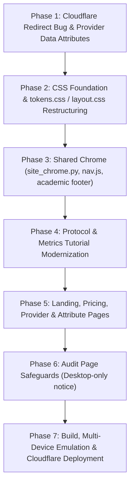

# Consolidated HTML Harmonization & Mobile Responsiveness Plan
**IndicGovBench-Orders Platform**  
*Document Version: 2.0 (Consolidated with Peer Review & Owner Directives) · Date: October 26, 2026*

---

## 1. Executive Summary & Scope Clarification

IndicGovBench-Orders serves two distinct user journeys:
1. **Public Reading & Exploration (Fully Mobile-Responsive)**:
   - Researchers, decision-makers, and developers reviewing benchmark results, rate cards, metric definitions, and attribute distributions.
   - **Target Viewports**: Smartphones (360px–480px), tablets (768px–1024px), and desktops.
   - **Pages**: Leaderboard (`index.html`), Pricing & Rate Card (`pricing.html`), Annotation Protocol (`protocol.html`), Metrics Tutorial (`metrics.html`), Attribute-Wise Explorer (`attributes.html`).
2. **Specialized Data Curation Workstations (Desktop-Oriented)**:
   - Annotators and ML engineers performing pixel-level bounding-box audits, multi-column transcription diff checks, and OCR correction.
   - **Target Viewports**: Desktop displays (≥1024px).
   - **Pages**: Document Audit Workspace (`audit.html`).
   - **Mobile Policy**: **Do not build complex mobile workflows (e.g. 3-tab touch annotation) for the audit workspace.** The audit tool requires precise mouse/keyboard controls, high-resolution split-screen rendering, and multi-pane comparisons. On mobile screens, the page will simply render the unified site header, prevent horizontal page-level viewport blowout, and display an informative notice indicating that document curation requires a desktop screen.

---

## 2. Key Owner Decisions & Overrides

| Area | Decision / Directive | Impact on Architecture |
|---|---|---|
| **Global Navigation** | **4 items only**: `Leaderboard`, `Pricing`, `Metrics`, `Attributes`. | **Do not link Protocol from anywhere** (leave out of header, drawer, footer, and landing page). The owner shares the protocol URL directly. `protocol.html` itself still receives the shared header/footer, design tokens, and mobile fixes. |
| **Audit Workspace Scope** | **Desktop-only tool.** No complex mobile audit view. | Drop the proposed 3-tab mobile segmented control. Only ensure the shared header renders and the outer viewport does not blow out horizontally on phone screens. |
| **Footer Specification** | Plain text, no emoji: `IndicGovBench-Orders — A standardized benchmark... Orgpedia Foundation · CC BY 4.0 · GitHub · HuggingFace · Contact: info@orgpedia.in`. | Displayed on all naturally scrolling pages (`index.html`, `pricing.html`, `protocol.html`, `metrics.html`, `attributes.html`). |
| **Color System** | **Slate palette** from `tokens.css` (`#0f172a`, `--border-subtle: #e2e8f0`, `--text-muted: #475569`). | Eliminate conflicting Tailwind gray declarations (`#111827`, `#e5e7eb`) and inline styles. |
| **Cloudflare Redirect Bug** | Fix immediately as **Step 1**. | Preserve query strings on redirect in `web/cloudflare/index.js`, and embed `data-provider` / `data-run` attributes into provider page markup so pages never misidentify themselves as Gemini. |

---

## 3. Structural & Architectural Improvements

### 3.1 Single Source of Truth for Header & Footer: `web/studio/site_chrome.py`
Instead of duplicating header HTML in 8 separate template files and in 5 different `innerHTML` calls in `js/app.js`, all chrome is generated from a single Python utility module:

```python
# web/studio/site_chrome.py

def render_header(
    active_nav: str = "",          # "leaderboard" | "pricing" | "metrics" | "attributes" | ""
    context_badge: str = "",       # e.g., "Leaderboard", "Pricing & Rate Card", "Gemini 3.1 Pro"
    actions_html: str = "",        # Page-specific toolbar buttons (e.g., Shortcuts, Back)
    show_nav: bool = True,         # False for minimalist mode
) -> str:
    """Renders the standard sticky #global-header and accessible mobile drawer."""
    ...

def render_footer() -> str:
    """Renders the clean academic CC BY 4.0 footer."""
    ...
```

- **Generators utilizing `site_chrome.py`**:
  - `web/studio/generate_landing_html.py` (via `index.template.html`)
  - `web/studio/generate_pricing_html.py`
  - `web/studio/generate_protocol_html.py`
  - `web/studio/generate_provider_pages.py`
  - `metrics_tutorial/generate_html.py`
- **Dynamic JS Handlers (`js/app.js`)**:
  - Replace the 5 repetitive header string builders with a single JS helper `renderSiteHeader({ activeNav, badge, actionsHtml })` that outputs identical DOM structure.
- **Mobile Navigation Drawer**:
  - Behavior managed by a dedicated `web/studio/static/js/nav.js` script.
  - Accessible: Uses CSS class toggling (not inline `style="display:none"`), includes `aria-expanded`, `aria-controls`, `aria-label`, closes on `Escape` or backdrop click, and returns focus to the hamburger button.
  - Automatically bundled into Cloudflare static export.

### 3.2 Splitting `layout.css`: Natural Scroll Base vs. `.app-shell`
`layout.css` currently forces `html, body { height: 100vh; width: 100vw; overflow: hidden; }` on every page that includes it, requiring 340+ `!important` overrides under `body.landing-mode`.

**New Clean Layout Architecture**:
1. **Base Styles (Default for all pages)**:
   - Clean, lightweight reset without blanket margin stripping (`* { box-sizing: border-box; }`).
   - Natural document scrolling: `html, body { min-height: 100%; width: 100%; overflow-y: auto; overflow-x: hidden; }`.
   - Use `width: 100%` instead of `width: 100vw` (eliminates horizontal overflow caused by scrollbars).
2. **Fixed Full-Viewport Workstations (`body.app-shell`)**:
   - Opt-in class applied **only** to desktop workstation views: `audit.html` and the interactive provider workspace.
   - Enforces `height: 100vh; overflow: hidden;` and internal pane scrolling.
3. **Deprecate `body.landing-mode` Overrides**:
   - Fold natural scrolling into the base rules, eliminating fragile `!important` overrides across `components.css`.

### 3.3 Anchor Target Clearance
Add a global anchor scroll-margin rule to ensure anchored jumps (e.g. `#section-results`, `#section-pricing`, protocol TOC links) do not get obscured behind the sticky header:
```css
[id] {
  scroll-margin-top: calc(var(--header-height, 48px) + 12px);
}
```

---

## 4. Page-by-Page Specifications

### 4.1 Landing Page & Leaderboard (`index.html`)
- **Header**: Unified header with 4 navigation links (`Leaderboard`, `Pricing`, `Metrics`, `Attributes`) and active indicator on `Leaderboard`.
- **Leaderboard Table vs. Cards**:
  - Implemented in `web/studio/static/js/landing.js`.
  - On viewports `<640px`, default initial view to **Cards View** using `window.matchMedia('(max-width: 640px)')`. User toggles between Table and Cards remain respected via sessionStorage.
  - Leaderboard table wrapped in `.benchmark-table-wrapper` with horizontal touch scrolling and sticky first column (`Model Name`).
- **Cost vs. Performance Plot**:
  - Responsive SVG scaling with horizontal swipe indicator on mobile screens.
- **Challenge Attribute Grid**:
  - Update `minmax(360px, 1fr)` to `minmax(min(100%, 320px), 1fr)` across `generate_landing_html.py`, `index.template.html`, and `attribute_catalog.js` (or replace with unified CSS class `.attribute-grid-col`).
- **Footer**: Append standard CC BY 4.0 academic footer.

### 4.2 Pricing & Implementation Rate Card (`pricing.html`)
- **Header**: Unified `#global-header` with `Pricing & Rate Card` badge.
- **Stale Links**: Remove dead/stale arXiv link.
- **CSS Clean-up**: Move styles from embedded `<style>` (`.pricing-stat-box`, `.compact-table`, `.source-*-link`) into `components.css`.
- **Responsive Table**:
  - Already inside `.benchmark-table-wrapper` (`overflow-x: auto`).
  - Add sticky styling for the `#` and `Model Name` columns (offsetting column 2 by column 1's width). Exclude `colspan="6"` category header rows from sticky positioning.
- **Footer**: Append standard academic footer.

### 4.3 Annotation Protocol Specification (`protocol.html`)
- **Header**: Render `#global-header` without Protocol in the navigation items (as specified by owner). Remove obsolete "Audit Workspace →" and "Metrics Demo ↗" buttons.
- **Layout & Typography**:
  - Link to `tokens.css` and new `layout.css`. Map old local variables (`--text-muted: #64748b`, `--accent: #2563eb`) to standardized tokens.
  - Enable natural window scrolling on mobile; update back-to-top button logic to listen to `window` scroll rather than `#main-reader`.
- **Mobile TOC Drawer**:
  - On screens `<768px`, `#toc-sidebar` transforms into an off-canvas drawer triggered by a sticky top bar: `[ 📑 Table of Contents (Sections 1–14) ▾ ]`.
  - Drawer closes automatically when any section link is tapped.
  - All headings (`h1–h4[id]`) receive `scroll-margin-top` to avoid header occlusion.
- **Footer**: Append standard academic footer.

### 4.4 Metrics Tutorial & Verification (`metrics.html`)
- **Header**: Insert standard `#global-header` with `Metrics` active badge and breadcrumb back to Leaderboard.
- **Layout & Test Case Selector**:
  - Remove `body { display: flex; height: 100vh; overflow: hidden; }`.
  - On screens `<768px`, convert fixed 340px sidebar into a top `<select>` dropdown or off-canvas drawer: `[ 🔬 Select Test Case: (Case 1/23) ▾ ]`.
- **Metrics Summary Banner**:
  - Restructure `.metrics-grid` from 4 rigid columns into a responsive grid: 4 columns on desktop, 2×2 on tablet, and 1 column on phones.
- **Side-by-Side Comparison Panes**:
  - Stack vertically on screens `<768px` (Ground Truth block followed by Prediction block).
- **2D Document Canvas Sheet**:
  - Replace fixed `height: 480px` with responsive `aspect-ratio` based on document dimensions, preventing distorted block overlays on mobile.
- **Footer**: Append standard academic footer.

### 4.5 Attribute-Wise Explorer (`attributes.html`)
- **Header**: Standard `#global-header` with `Attributes` badge.
- **Layout**: Stack faceted filter sidebar above the distribution matrix on screens `<768px`.
- **Footer**: Append standard academic footer.

### 4.6 Provider Workspace Pages (`provider_*.html` & `provider.html`)
- **Bug Fix**: Write `<body data-provider="<provider>" data-run="<run_id>">` in `generate_provider_pages.py`. Update `js/provider_page.js` to read dataset attributes first, preventing incorrect fallback to Gemini on Cloudflare.
- **Context Badge**: Display formal model name (e.g. `Gemini 3.1 Pro`) from `PROVIDER_DISPLAY_NAMES` rather than raw slug `gemini_3_1_pro (default)`.
- **Document Table**: Apply sticky styling to `Document ID` column; wrap table in `.doc-list-table-wrapper` with horizontal touch scrolling.

### 4.7 Document Audit Workspace (`audit.html`)
- **Desktop Only**: Kept as a precision desktop curation workstation.
- **Mobile Safeguards**:
  - Render shared header.
  - Prevent viewport clipping / horizontal page blowout.
  - Display non-intrusive banner on viewports `<768px`: *"IndicGovBench Curation Studio is optimized for desktop displays with keyboard shortcuts and high-resolution bbox inspection."*

---

## 5. Phased Implementation Roadmap



### Phase 1: Cloudflare Bug Fix & Provider Attribution
1. Update `web/cloudflare/index.js` redirect logic to preserve query strings:
   `return Response.redirect(new URL(`/provider_${prov}${url.search}`, request.url), 302);`
2. Update `web/studio/generate_provider_pages.py` to write `data-provider` and `data-run` on `<body>`.
3. Update `web/studio/static/js/provider_page.js` to prioritize DOM dataset attributes over missing query parameters.
4. Add unit test verifying that generated provider HTML files contain correct `data-provider` attributes.

### Phase 2: CSS Foundation & Layout Decoupling
1. Split `web/studio/static/css/layout.css`:
   - Base defaults: Natural document scrolling, `width: 100%`, smooth scroll.
   - Workstation shell: Encapsulate 100vh lock under `body.app-shell`.
2. Retire `body.landing-mode` override bloat in `components.css`.
3. Standardize Slate design tokens in `tokens.css`.
4. Add anchor offset rule: `[id] { scroll-margin-top: calc(var(--header-height) + 12px); }`.
5. Add responsive utility classes: `.table-scroll-wrapper`, `.sticky-col`, `.mobile-only`, `.desktop-only`.

### Phase 3: Shared Site Chrome (`site_chrome.py` & `nav.js`)
1. Create `web/studio/site_chrome.py` implementing `render_header()` (4-item nav) and `render_footer()`.
2. Create accessible `web/studio/static/js/nav.js` for mobile drawer open/close and keyboard focus management.
3. Update `web/studio/static/js/app.js` with unified header rendering function and page actions slot.

### Phase 4: Protocol & Metrics Tutorial Modernization
1. Update `web/studio/generate_protocol_html.py`:
   - Incorporate `site_chrome.py`.
   - Remove Protocol link from header navigation.
   - Implement mobile TOC slide-over drawer and heading scroll margins.
2. Update `metrics_tutorial/generate_html.py`:
   - Incorporate `site_chrome.py`.
   - Responsive 2×2 / 1-column metrics grid.
   - Vertically stacked Ground Truth vs. Prediction panes on mobile.
   - Responsive aspect-ratio for `.doc-sheet`.

### Phase 5: Landing, Pricing & Provider Workspaces Refinement
1. Update `web/studio/generate_pricing_html.py`: Move inline styles to `components.css`; add sticky model column.
2. Update `web/studio/templates/index.template.html` and `generate_landing_html.py`: Fix attribute grid minmax; incorporate footer.
3. Update `web/studio/static/js/landing.js`: Default to Cards View on screens `<640px`.
4. Update `web/studio/generate_provider_pages.py` and `static/attributes.html`.

### Phase 6: Audit Workspace Safeguards
1. Update `web/studio/static/audit.html` and `js/app.js` to render shared header without overflowing viewport.
2. Add desktop-recommended notice for viewports `<768px`.

### Phase 7: Verification, Multi-Device Emulation & Deployment
1. Run `make html` to recompile all assets.
2. Test viewports across 6 responsive widths:
   - **375px** (iPhone SE)
   - **412px** (Google Pixel / Samsung Galaxy)
   - **768px** (iPad Portrait)
   - **900px** (Small Laptop / Tablet Landscape)
   - **1024px** (Desktop Boundary)
   - **1440px** (Standard Desktop)
3. Deploy to Cloudflare via `make cf_deploy SKIP_IMAGES=1`.

---

## 6. Verification Checklist & Acceptance Criteria

- [ ] **Navigation Protocol Integrity**: No link to `/protocol` or `protocol.html` appears in any header, mobile drawer, footer, or landing page. Existing assertions in `tests/test_studio.py` pass.
- [ ] **Cloudflare Provider Routing**: Visiting `/provider?provider=tesseract` on Cloudflare loads Tesseract with `#provider-header-badge` showing `Tesseract 5.3` and clicking audit rows opens Tesseract's document evaluation.
- [ ] **Unified Chrome**: Every page uses identical header branding (`🏛️ IndicGovBench-Orders`), identical active navigation styles, and identical CC BY 4.0 footer.
- [ ] **Zero Viewport Blowout**: No horizontal page scrollbars appear at `375px` or `412px` width on any page (including audit).
- [ ] **Audit Workspace Policy**: Audit workspace remains a specialized desktop tool; mobile displays shared header and responsive notice without broken multi-pane splits.
- [ ] **Anchor Clearance**: Clicking navigation anchors (e.g. `#section-results`) lands with the heading visible cleanly below the sticky header.
- [ ] **Accessible Drawer**: Mobile drawer opens via hamburger, traps focus appropriately, closes on Escape/backdrop click, and returns focus.
- [ ] **Clean Code & Less Inline CSS**: Inline `style=` counts decrease, and no new `!important` rules are introduced.
- [ ] **Tracking Segregation**: Local files in `web/studio/static/` remain 100% tracking-free; Clarity tracking is injected only during Cloudflare export.
