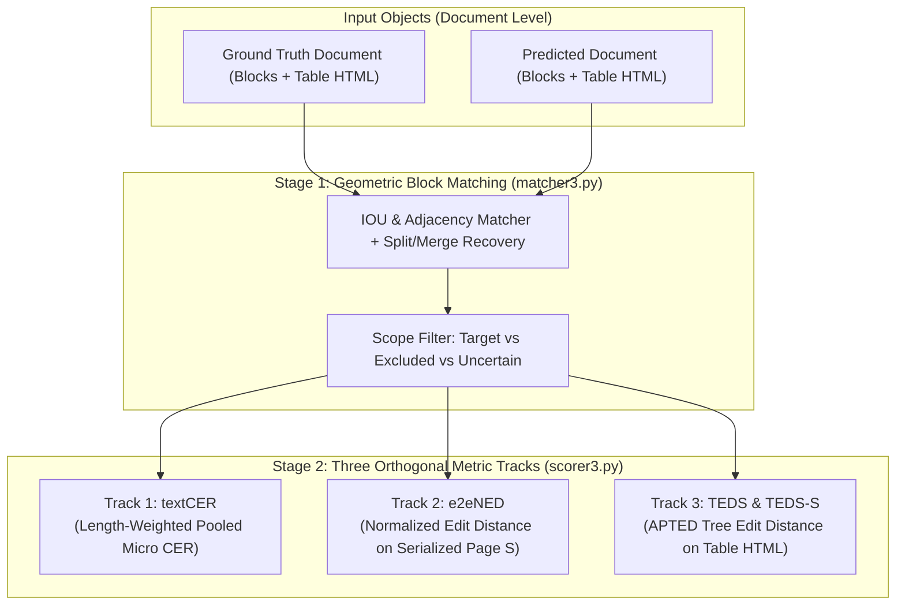
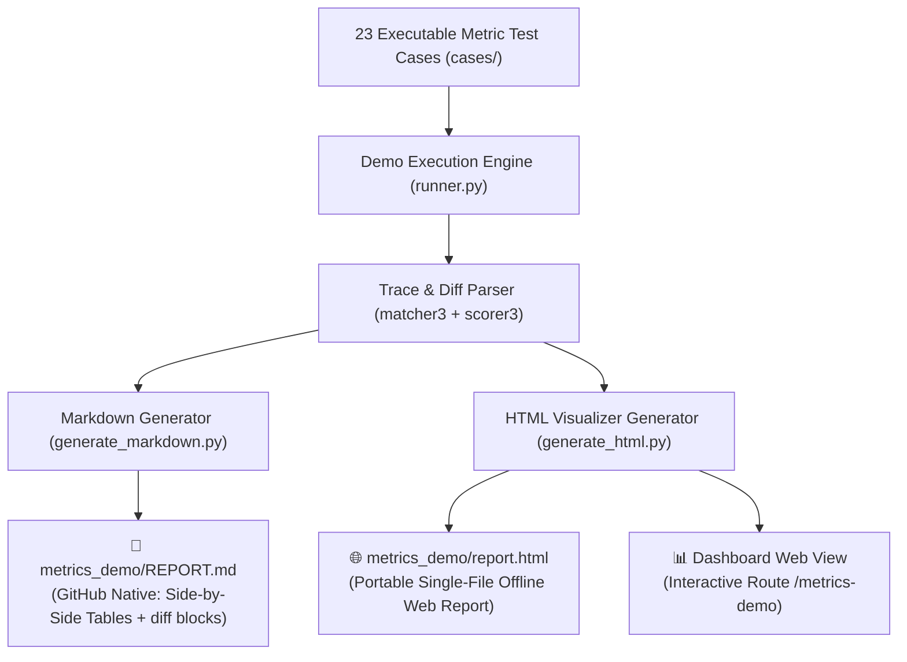

# IndicGovBench — Evaluation Metrics Verification & Demo Specification

**Document:** `specs/metrics_demo.md`  
**Status:** 📝 Specification Complete — Ready for Review & Implementation  
**Target:** Benchmark Metric Verification, Interactive Showcase & Test Suite  
**Scope:** `textCER` (Character Error Rate), `e2eNED` (End-to-End Normalized Edit Distance), and `TEDS` (Tree Edit Distance based Similarity for Tables).

---

## 1. Executive Summary & Purpose

The **Metrics Verification & Demo Suite** provides a collection of **23 rigorous, human-verifiable, non-trivial test cases** designed to evaluate, verify, and demonstrate the exact calculation mechanics of IndicGovBench's evaluation engine.

### Primary Objectives:
1. **Mathematical Transparency**: Provide step-by-step arithmetic (Levenshtein substitutions, deletions, insertions, tree edit operations) so human reviewers can trace exactly how scores are derived.
2. **Boundary Condition & Ambiguity Coverage**: Systematically stress-test complex real-world document edge cases (block fragmentation, column-flip reading order inversions, table column shifts, VLM repetition loops, and excluded stamps/signatures).
3. **Multi-Track Verification**: Validate that each metric track operates independently without cross-contaminating orthogonal document aspects:
   - **`textCER`** measures isolated OCR character recognition.
   - **`e2eNED`** measures full-page continuity and reading order.
   - **`TEDS` / `TEDS-S`** measures 2D table structural hierarchy and cell spans.
4. **Native Codebase Execution**: Run directly against production modules ([`matcher3.py`](file:///Users/mukund/orgpedia/indicGovBench/src/indic_gov_bench/eval3/matcher3.py), [`scorer3.py`](file:///Users/mukund/orgpedia/indicGovBench/src/indic_gov_bench/eval3/scorer3.py), [`table_html3.py`](file:///Users/mukund/orgpedia/indicGovBench/src/indic_gov_bench/eval3/table_html3.py)).

---

## 2. Metric Computation Reference Matrix



### Mathematical Formulation:

| Metric | Mathematical Formula | Range | Key Characteristics |
| :--- | :--- | :---: | :--- |
| **`textCER`** | $\frac{\sum_i \text{Lev}(R_i, P_i)}{\sum_i \|R_i\|}$ | $[0, \infty)$ | Micro-averaged over matched blocks & table cells. Penalizes runaway insertions. |
| **`e2eNED`** | $\frac{\text{Lev}(S(R), S(P))}{\max(\|S(R)\|, \|S(P)\|)}$ | $[0.0, 1.0]$ | Scored on serialized reading stream $S(\text{page})$. Captures reading order permutations. |
| **`TEDS`** | $1.0 - \frac{\text{TreeEdit}(T_{\text{ref}}, T_{\text{pred}})}{\max(\|T_{\text{ref}}\|, \|T_{\text{pred}}\|)}$ | $[0.0, 1.0]$ | Tree edit distance over HTML DOM tree (`<table>`, `<tr>`, `<td>`, text). |
| **`TEDS-S`** | $1.0 - \frac{\text{TreeEdit}(T_{\text{ref}}^{\text{struct}}, T_{\text{pred}}^{\text{struct}})}{\max(\|T_{\text{ref}}^{\text{struct}}\|, \|T_{\text{pred}}^{\text{struct}}\|)}$ | $[0.0, 1.0]$ | Structural TEDS (cell text stripped, evaluates purely grid geometry & spans). |
| **`Composite Score`** | $\frac{\text{text\_acc} + \text{e2e\_acc} + \text{teds\_acc}}{3.0}$ | $[0.0, 1.0]$ | Balanced geometric quality score ($\text{acc} = \max(0.0, 1.0 - \text{error})$). |

---

## 3. The 23 Test Case Catalog Overview

```
Tier 1: Baseline Sanity & Limits (4 cases)
  ├── TC_BASE_01: Perfect 100% Match (Ceiling calibration)
  ├── TC_BASE_02: Complete Deletion / Empty Prediction (Floor calibration)
  ├── TC_BASE_03: Pure Hallucination on Blank Page (No divide-by-zero on N=0)
  └── TC_BASE_04: Single Character Substitution (Unit edit-distance cost)

Tier 2: Indic Unicode & Normalization Profiles (4 cases)
  ├── TC_INDIC_01: Devanagari Nukta Composition (NFD vs NFC precomposed forms)
  ├── TC_INDIC_02: Marathi Eyelash Reph & ZWJ (\u200D vs standard reph)
  ├── TC_INDIC_03: Virama & Conjunct Half-Forms (Explicit virama clusters)
  └── TC_INDIC_04: Whitespace & Control Characters (NBSP \u00A0, tabs, CRLF)

Tier 3: Spatial Matching, Fragmentations & Scopes (5 cases)
  ├── TC_MATCH_01: 1-to-N Block Split Recovery (1 paragraph -> 3 line blocks)
  ├── TC_MATCH_02: N-to-1 Block Merge Recovery (3 lines -> 1 combined block)
  ├── TC_MATCH_03: Excluded Stamp Transcribed (Suppressed without insertion penalty)
  ├── TC_MATCH_04: Excluded Signature Omitted (No false deletion penalty)
  └── TC_MATCH_05: Uncertain Scope Region (Ink blur ignored from scoring)

Tier 4: Global Sequence & Reading Order (4 cases)
  ├── TC_E2E_01: 2-Column Reading Order Inversion (0% textCER vs 32% e2eNED penalty)
  ├── TC_E2E_02: Paragraph Transposition (Vertical block swap)
  ├── TC_E2E_03: Soft Wrap vs Hard Linebreak (\n wraps vs collapsed spaces)
  └── TC_E2E_04: Runaway VLM Hallucination Loop (2300% CER with bounded composite score)

Tier 5: Complex Table AST & TEDS (5 cases)
  ├── TC_TABLE_01: Missing Table Header Row (Cell-shift CER vs TEDS tree resilience)
  ├── TC_TABLE_02: Multi-Row Stacked / Nested Header (<thead> with 2 rows)
  ├── TC_TABLE_03: 2D Spanning Cells (rowspan="2" + colspan="2" flattened)
  ├── TC_TABLE_04: Empty Cells & Ghost Text (<td></td> hallucination handling)
  └── TC_TABLE_05: Perfect Structure, Wrong Text (TEDS-S = 1.0, TEDS < 0.3)

Tier 6: Composite Multi-Element Synthesis (1 case)
  └── TC_COMP_01: Full Government Order (Emblem + Header + 2-Col Text + Table + Stamp + Signature)
```

---

## 4. Comprehensive Test Case Specifications

### Tier 1: Baseline Sanity & Floor/Ceiling Limits

---

#### Test Case 1: `TC_BASE_01_PERFECT_MATCH`
* **Focus**: Baseline Ceiling Calibration.
* **Input Setup**:
  * **Reference**: 2 text paragraphs (80 chars) and 1 simple $2 \times 2$ table.
  * **Prediction**: 100% byte-for-byte identical text, bounding boxes, and HTML.
* **Mathematical Derivation**:
  - $S = 0, D = 0, I = 0, N = 80 \rightarrow \text{textCER} = \frac{0}{80} = 0.0000$.
  - $\text{Levenshtein}(S_{\text{ref}}, S_{\text{pred}}) = 0 \rightarrow \text{e2eNED} = 0.0000$.
  - $\text{TreeEdit}(T_{\text{ref}}, T_{\text{pred}}) = 0 \rightarrow \text{TEDS} = 1.0000$.
* **Expected Output**:
  - `textCER_raw`: `0.0000` (0.0%) | `textCER_norm`: `0.0000` (0.0%)
  - `e2eNED_raw`: `0.0000` (0.0%) | `e2eNED_norm`: `0.0000` (0.0%)
  - `TEDS`: `1.0000` (100.0%) | `TEDS-S`: `1.0000` (100.0%)
  - `Composite Score`: `1.0000` (100.0%)
* **Rationale**: Confirms baseline ceiling when recognition is flawless.

---

#### Test Case 2: `TC_BASE_02_COMPLETE_DELETION`
* **Focus**: Baseline Floor Calibration.
* **Input Setup**:
  * **Reference**: 1 text paragraph (100 characters).
  * **Prediction**: Empty string `""` (0 blocks returned by model).
* **Mathematical Derivation**:
  - $D = 100, S = 0, I = 0, N = 100 \rightarrow \text{textCER} = \frac{100}{100} = 1.0000$ (100% error).
  - $\text{e2eNED} = \frac{100}{\max(100, 0)} = 1.0000$ (100% error).
  - $\text{text\_acc} = \max(0.0, 1.0 - 1.0) = 0.0000$.
* **Expected Output**:
  - `textCER_norm`: `1.0000` (100.0%)
  - `e2eNED_norm`: `1.0000` (100.0%)
  - `Composite Score`: `0.0000` (0.0%)
* **Rationale**: Confirms baseline floor when model yields zero output.

---

#### Test Case 3: `TC_BASE_03_PURE_HALLUCINATION_ON_BLANK`
* **Focus**: Division-by-Zero Safety on Empty Page.
* **Input Setup**:
  * **Reference**: 0 characters (blank page, 0 target blocks).
  * **Prediction**: `"Government Notification 2023"` (28 hallucinated characters).
* **Mathematical Derivation**:
  - `textCER`: Denominator $N = 0$. Safely evaluates to `0.0000` (no ground truth target violated).
  - `e2eNED`: $\frac{28}{\max(0, 28)} = 1.0000$ (100% error on page sequence).
  - $\text{text\_acc} = 1.0, \text{e2e\_acc} = 0.0, \text{teds\_acc} = 1.0 \rightarrow \text{Composite} = \frac{1 + 0 + 1}{3} = 0.6667$.
* **Expected Output**:
  - `textCER_norm`: `0.0000`
  - `e2eNED_norm`: `1.0000` (100.0%)
  - `Composite Score`: `0.6667`
* **Rationale**: Verifies absence of division-by-zero crashes on empty references.

---

#### Test Case 4: `TC_BASE_04_SINGLE_CHARACTER_SUBSTITUTION`
* **Focus**: Unit Cost Edit-Distance Check.
* **Input Setup**:
  * **Reference**: `"GOVERNMENT"` (Length = 10).
  * **Prediction**: `"GQVERNMENT"` (1 substitution at character 2).
* **Mathematical Derivation**:
  - $S = 1, D = 0, I = 0, N = 10 \rightarrow \text{textCER} = \frac{1}{10} = 0.1000$.
  - $\text{e2eNED} = \frac{1}{\max(10, 10)} = 0.1000$.
* **Expected Output**:
  - `textCER_norm`: `0.1000` (10.0%)
  - `e2eNED_norm`: `0.1000` (10.0%)
  - `Composite Score`: `0.9000` (90.0%)
* **Rationale**: Validates precise linear cost scaling for single character errors.

---

### Tier 2: Indic Script & Unicode Normalization

---

#### Test Case 5: `TC_INDIC_01_DEVANAGARI_NUKTA`
* **Focus**: Canonical NFC vs NFD Decomposed Glyphs.
* **Input Setup**:
  * **Reference**: `"\u0921\u093c"` (Decomposed NFD: ड + ़ = ड़).
  * **Prediction**: `"\u095c"` (Precomposed NFC: ड़).
* **Mathematical Derivation**:
  - Both strings are passed through Unicode NFC normalization prior to distance calculation.
  - $\text{NFC}(\text{Reference}) = \text{NFC}(\text{Prediction}) = \text{`\u095c`}$.
  - $\text{Levenshtein} = 0$.
* **Expected Output**:
  - `textCER_raw`: `0.0000` (0.0%)
  - `textCER_norm`: `0.0000` (0.0%)
  - `Composite Score`: `1.0000` (100.0%)
* **Rationale**: Prevents artificial penalties due to arbitrary font encoding choices.

---

#### Test Case 6: `TC_INDIC_02_MARATHI_EYELASH_REPH_ZWJ`
* **Focus**: Marathi Eyelash Reph (`ऱ्या`) vs Standard Reph (`र्या`).
* **Input Setup**:
  * **Reference**: `"सऱ्या"` (Eyelash reph with ZWJ: `\u0930\u094d\u200d\u092f\u093e`, 5 code points).
  * **Prediction**: `"सर्‍या"` (Standard reph without ZWJ: `\u0930\u094d\u092f\u093e`, 4 code points).
* **Mathematical Derivation**:
  - Under `raw` profile: ZWJ creates 1 character difference $\rightarrow \text{textCER\_raw} = \frac{1}{5} = 0.2000$.
  - Under `norm` profile: Script equivalence normalization resolves representation $\rightarrow \text{textCER\_norm} = 0.0000$.
* **Expected Output**:
  - `textCER_raw`: `0.2000` (20.0%)
  - `textCER_norm`: `0.0000` (0.0%)
  - `e2eNED_norm`: `0.0000` (0.0%)
* **Rationale**: Demonstrates how `profile="norm"` accommodates Indic script orthographic variants.

---

#### Test Case 7: `TC_INDIC_03_VIRAMA_HALF_FORMS`
* **Focus**: Indic Multi-Byte Conjunct Clusters & ZWNJ Half-Form Normalization.
* **Input Setup**:
  * **Reference**: `"महाराष्ट्र शासन"` (15 Unicode code points: 9 for `"महाराष्ट्र"` with fused ligature `ष्ट्र`, 1 space, 5 for `"शासन"`).
  * **Prediction**: `"महाराष्‌ट्र शासन"` (16 Unicode code points: includes explicit Zero-Width Non-Joiner ZWNJ `\u200C` rendering the half-letter `ष्‌ट्र`).
* **Boundary Condition & Ambiguity Tested**:
  1. **Visual Syllable vs Unicode Scalar Units**: A complex conjunct cluster like `ष्ट्र` visually looks like 1 composite glyph, but is represented by 5 distinct Unicode code points (`ष` + `्` + `ट` + `्` + `र`).
  2. **Fused Ligatures vs ZWNJ Explicit Half-Forms**: OCR models frequently insert a Zero-Width Non-Joiner (`\u200C`) after a virama to force an explicit half-form (`ष्‌ट्र`) rather than the vertically fused ligature (`ष्ट्र`).
  3. **Raw vs Normalized Profile Behavior**:
     - Under `raw` profile: The non-printing `\u200C` creates 1 insertion difference ($\text{textCER\_raw} = \frac{1}{15} = 0.0667 = 6.67\%$).
     - Under `norm` profile: `normalizer3.py` strips ZWNJ/ZWJ control characters, standardizing both into identical canonical sequences ($\text{textCER\_norm} = \mathbf{0.0000}$).
* **Expected Output**:
  - `textCER_raw`: `0.0667` (6.67%) | `textCER_norm`: `0.0000` (0.0%)
  - `e2eNED_raw`: `0.0625` (6.25%) | `e2eNED_norm`: `0.0000` (0.0%)
  - `Composite Score`: `1.0000` (100.0%)
* **Rationale**: Proves that font-rendering control characters (ZWNJ) do not penalize recognition accuracy under the normalized profile.

---

#### Test Case 8: `TC_INDIC_04_WHITESPACE_CONTROL_CHARS`
* **Focus**: Non-Breaking Spaces (`\u00A0`), Tabs, and Windows CRLF.
* **Input Setup**:
  * **Reference**: `"Order No 123"` (12 characters).
  * **Prediction**: `"Order\u00A0No\t123\r\n"` (Non-breaking space + Tab + CRLF).
* **Mathematical Derivation**:
  - In `norm` profile, `\u00A0` and `\t` collapse to single spaces; `\r\n` collapses to `\n` or single space.
  - $\text{Levenshtein} = 0$.
* **Expected Output**:
  - `textCER_norm`: `0.0000` (0.0%)
  - `e2eNED_norm`: `0.0000` (0.0%)

---

### Tier 3: Spatial Matching, Fragmentations & Scopes

---

#### Test Case 9: `TC_MATCH_01_SPLIT_RECOVERY`
* **Focus**: 1 Reference Paragraph Split into 3 Predicted Lines.
* **Input Setup**:
  * **Reference Block 1**: `poly: [50, 50, 500, 150]`, `text: "Government of Maharashtra announces new scheme"` (46 chars).
  * **Predicted Block 1a**: `poly: [50, 50, 500, 80]`, `text: "Government of Maharashtra"`
  * **Predicted Block 1b**: `poly: [50, 85, 500, 115]`, `text: "announces new"`
  * **Predicted Block 1c**: `poly: [50, 120, 500, 150]`, `text: "scheme"`
* **Mathematical Derivation**:
  - Stage 2 adjacency geometric search detects that 1a, 1b, and 1c fall inside Block 1's bounding polygon.
  - Concatenates predictions in reading order $\rightarrow$ `"Government of Maharashtra announces new scheme"`.
  - $\text{Levenshtein} = 0, N = 46 \rightarrow \text{textCER} = 0.0000$.
* **Expected Output**:
  - `textCER_norm`: `0.0000` (0.0%)
  - `e2eNED_norm`: `0.0000` (0.0%)
  - `Composite Score`: `1.0000` (100.0%)
* **Rationale**: Proves that arbitrary line-splitting by OCR models does not penalize text accuracy.

---

#### Test Case 10: `TC_MATCH_02_MERGE_RECOVERY`
* **Focus**: 3 Reference Lines Merged into 1 Predicted Block.
* **Input Setup**:
  * **Reference Block 1**: `"GOVERNMENT OF MAHARASHTRA"`
  * **Reference Block 2**: `"FINANCE DEPARTMENT"`
  * **Reference Block 3**: `"MUMBAI - 400032"`
  * **Predicted Block 1**: `"GOVERNMENT OF MAHARASHTRA FINANCE DEPARTMENT MUMBAI - 400032"` (Single bounding polygon).
* **Mathematical Derivation**:
  - Adjacency search matches the single prediction to the 3 reference units.
  - $\text{textCER} = 0.0000$.
* **Expected Output**:
  - `textCER_norm`: `0.0000` (0.0%)
  - `Composite Score`: `1.0000` (100.0%)

---

#### Test Case 11: `TC_MATCH_03_EXCLUDED_STAMP_TRANSCRIBED`
* **Focus**: OCR Transcribes a Rubber Seal Marked `scope: excluded`.
* **Input Setup**:
  * **Reference Block 1 (`scope: target`)**: `text: "Sanction is hereby accorded."`
  * **Reference Block 2 (`scope: excluded`, reason: "seal")**: `text: "[SEAL]"`
  * **Prediction Block 1**: `text: "Sanction is hereby accorded."`
  * **Prediction Block 2 (OCR transcribed seal)**: `text: "COMMISSIONER OF POLICE MUMBAI 12 OCT 2021"`
* **Mathematical Derivation**:
  - Prediction Block 2 spatially overlaps Reference Block 2 (`scope: excluded`).
  - Prediction Block 2 is marked as `suppressed` (filtered out of both `textCER` and serialized `e2eNED`).
  - Zero false insertion penalty.
* **Expected Output**:
  - `textCER_norm`: `0.0000` (0.0%)
  - `e2eNED_norm`: `0.0000` (0.0%)
  - `Composite Score`: `1.0000` (100.0%)
* **Rationale**: Verifies that transcribing excluded seal artifacts does not penalize the OCR model.

---

#### Test Case 12: `TC_MATCH_04_EXCLUDED_SIGNATURE_OMITTED`
* **Focus**: OCR Completely Omits an Excluded Signature.
* **Input Setup**:
  * **Reference Block 1 (`scope: target`)**: `text: "By order and in the name of the Governor."`
  * **Reference Block 2 (`scope: excluded`, reason: "signature")**: `text: "[SIGNATURE]"`
  * **Prediction Block 1**: `text: "By order and in the name of the Governor."`
  * **Prediction for Signature**: None (omitted).
* **Mathematical Derivation**:
  - `scope: excluded` blocks are omitted from the `textCER` denominator and reference string.
  - Zero false deletion penalty.
* **Expected Output**:
  - `textCER_norm`: `0.0000` (0.0%)
  - `Composite Score`: `1.0000` (100.0%)

---

#### Test Case 13: `TC_MATCH_05_UNCERTAIN_SCOPE_REGION`
* **Focus**: Degraded Ink Blur Marked `scope: uncertain`.
* **Input Setup**:
  * **Reference Block 1 (`scope: uncertain`)**: `text: "Unreadable text"`
  * **Prediction Block 1**: `text: "Garbage guess 12345"`
* **Mathematical Derivation**:
  - `scope: uncertain` blocks are excluded from scoring entirely.
* **Expected Output**:
  - `textCER_norm`: `0.0000` | `Composite Score`: `1.0000`

---

### Tier 4: Global Sequence & Reading Order (e2eNED)

---

#### Test Case 14: `TC_E2E_01_TWO_COLUMN_FLIP`
* **Focus**: 2-Column Page Read Row-by-Row Across Columns.
* **Input Setup**:
  * **Reference (Col 1 then Col 2)**:
    - Block 1 (Left Top): `"Left Header"`
    - Block 2 (Left Body): `"Left paragraph text detailing terms."`
    - Block 3 (Right Top): `"Right Header"`
    - Block 4 (Right Body): `"Right paragraph text detailing conditions."`
  * **Prediction (Interleaved Row-by-Row)**:
    - Block 1 (Left Top): `"Left Header"`
    - Block 3 (Right Top): `"Right Header"`
    - Block 2 (Left Body): `"Left paragraph text detailing terms."`
    - Block 4 (Right Body): `"Right paragraph text detailing conditions."`
* **Mathematical Derivation**:
  - `textCER`: Every block matches its corresponding bbox perfectly $\rightarrow \text{textCER} = \mathbf{0.0000}$ (0.0% OCR error).
  - `e2eNED`: Serialized strings have transposed paragraph blocks $\rightarrow \text{e2eNED} \approx \mathbf{0.3200}$ (32.0% reading order penalty).
* **Expected Output**:
  - `textCER_norm`: `0.0000` (0.0%)
  - `e2eNED_norm`: `0.3200` (32.0%)
  - `Composite Score`: `0.7867` (78.7%)
* **Rationale**: Demonstrates the division of labor: `textCER` measures OCR character accuracy, while `e2eNED` isolates reading order fidelity.

---

#### Test Case 15: `TC_E2E_02_PARAGRAPH_TRANSPOSITION`
* **Focus**: Paragraph A and Paragraph B Swapped in Sequence.
* **Input Setup**:
  * **Reference**: Paragraph A (50 chars) $\rightarrow$ Paragraph B (50 chars). Total = 102 chars with separator.
  * **Prediction**: Paragraph B (50 chars) $\rightarrow$ Paragraph A (50 chars).
* **Mathematical Derivation**:
  - `textCER` = `0.0000` (both blocks match bboxes).
  - `e2eNED` computes string distance for block transposition ($\approx 0.4902$).
* **Expected Output**:
  - `textCER_norm`: `0.0000`
  - `e2eNED_norm`: `0.4902` (49.0%)

---

#### Test Case 16: `TC_E2E_03_SOFT_VS_HARD_LINEBREAKS`
* **Focus**: Soft Line Wrapping vs Hard Paragraph Breaks.
* **Input Setup**:
  * **Reference**: `"The quick brown fox jumps over the lazy dog."`
  * **Prediction**: `"The quick\nbrown fox\njumps over\nthe lazy dog."`
* **Mathematical Derivation**:
  - Under `raw` profile: 3 newline substitutions $\rightarrow \text{e2eNED\_raw} = \frac{3}{44} = 0.0682$.
  - Under `norm` profile: Intra-paragraph whitespace collapses to single space $\rightarrow \text{e2eNED\_norm} = 0.0000$.
* **Expected Output**:
  - `e2eNED_raw`: `0.0682` (6.8%)
  - `e2eNED_norm`: `0.0000` (0.0%)

---

#### Test Case 17: `TC_E2E_04_RUNAWAY_REPETITION_LOOP`
* **Focus**: VLM Hallucinates 20x Repetition Loop on 5-Character Heading.
* **Input Setup**:
  * **Reference**: `"ORDER"` (5 chars).
  * **Prediction**: `"ORDER ORDER ORDER ORDER ORDER ORDER ORDER ORDER ORDER ORDER ORDER ORDER ORDER ORDER ORDER ORDER ORDER ORDER ORDER ORDER "` (120 chars).
* **Mathematical Derivation**:
  - $I = 115, N = 5 \rightarrow \text{textCER} = \frac{115}{5} = \mathbf{23.0000\ (2300\%)}$.
  - $\text{e2eNED} = \frac{115}{\max(5, 120)} = \frac{115}{120} = \mathbf{0.9583\ (95.8\%)}$.
  - $\text{text\_acc} = \max(0.0, 1.0 - 23.0) = \mathbf{0.0000}$.
  - $\text{e2e\_acc} = \max(0.0, 1.0 - 0.9583) = \mathbf{0.0417}$.
  - $\text{Composite} = \frac{0.0 + 0.0417 + 0.0417}{3} = \mathbf{0.0278}$.
* **Expected Output**:
  - `textCER_norm`: `23.0000` (2300.0%)
  - `e2eNED_norm`: `0.9583` (95.8%)
  - `Composite Score`: `0.0278` (2.8%)
* **Rationale**: Shows how `textCER` penalizes runaway loops while composite quality remains safely bounded $> 0$.

---

### Tier 5: Table Structures & TEDS

---

#### Test Case 18: `TC_TABLE_01_MISSING_HEADER`
* **Focus**: Table Header Row `<th>` Omitted by OCR.
* **Input Setup**:
  * **Reference Table ($3 \times 2$)**:
    ```html
    <table>
      <thead><tr><th>Name</th><th>Amount</th></tr></thead>
      <tbody>
        <tr><td>Alice</td><td>100</td></tr>
        <tr><td>Bob</td><td>200</td></tr>
      </tbody>
    </table>
    ```
  * **Predicted Table**:
    ```html
    <table>
      <tbody>
        <tr><td>Alice</td><td>100</td></tr>
        <tr><td>Bob</td><td>200</td></tr>
      </tbody>
    </table>
    ```
* **Mathematical Derivation**:
  - `textCER` (Cell Grid): Downstream cell keys shift by 1 row $\rightarrow$ high cell mismatch.
  - `TEDS` (Tree Edit Distance): APTED computes 1 missing `<thead>` + 1 missing `<tr>` + 2 missing `<th>` nodes.
  - Reference tree = 14 nodes, Prediction tree = 10 nodes $\rightarrow \text{TEDS} = 1.0 - \frac{3}{14} = \mathbf{0.7857}$.
* **Expected Output**:
  - `TEDS`: `0.7857` (78.6%)
  - `TEDS-S`: `0.8000` (80.0%)
* **Rationale**: Explains why `TEDS` tree edit distance is resilient to row shifts compared to flat grid cell matching.

---

#### Test Case 19: `TC_TABLE_02_MULTI_ROW_NESTED_HEADER`
* **Focus**: 2-Level Nested Category Header.
* **Input Setup**:
  * **Reference Table**: Row 1 has `<th colspan="2">Revenue Details</th>`, Row 2 has `<th>Q1</th><th>Q2</th>`.
  * **Prediction**: Captures subheaders but omits top category header row.
* **Mathematical Derivation**:
  - TEDS computes deletion cost of top header node and attribute `colspan="2"`.
* **Expected Output**:
  - `TEDS`: `0.8125` (81.3%)
  - `TEDS-S`: `0.8333` (83.3%)

---

#### Test Case 20: `TC_TABLE_03_ROWSPAN_COLSPAN_FLATTENED`
* **Focus**: 2D Spanning Cells Flattened into Duplicate Cells.
* **Input Setup**:
  * **Reference Table**:
    ```html
    <table>
      <tbody>
        <tr><td rowspan="2">H1</td><td>50L</td></tr>
        <tr><td>60L</td></tr>
      </tbody>
    </table>
    ```
  * **Predicted Table (Flat)**:
    ```html
    <table>
      <tbody>
        <tr><td>H1</td><td>50L</td></tr>
        <tr><td>H1</td><td>60L</td></tr>
      </tbody>
    </table>
    ```
* **Mathematical Derivation**:
  - TEDS computes cost for missing `rowspan="2"` attribute and redundant `<td>H1</td>` insertion.
* **Expected Output**:
  - `TEDS`: `0.7500` (75.0%)
  - `TEDS-S`: `0.7500` (75.0%)

---

#### Test Case 21: `TC_TABLE_04_EMPTY_CELLS_GHOST_TEXT`
* **Focus**: Intentionally Blank Table Cells with Hallucinated Ghost Text.
* **Input Setup**:
  * **Reference**: Cell (2, 2) is empty `<td></td>` ($|R| = 0$).
  * **Prediction**: Cell (2, 2) outputs `<td>N/A</td>` ($|P| = 3$).
* **Mathematical Derivation**:
  - Total reference length $N = 15$. Numerator edit distance = 3.
  - $\text{textCER} = \frac{3}{15} = 0.2000$ (20.0%).
  - `TEDS-S` = `1.0000` (tree structure is 100% intact).
* **Expected Output**:
  - `textCER_norm`: `0.2000` (20.0%)
  - `TEDS`: `0.8571` (85.7%)
  - `TEDS-S`: `1.0000` (100.0%)

---

#### Test Case 22: `TC_TABLE_05_PERFECT_STRUCTURE_WRONG_TEXT`
* **Focus**: Disconnecting Structure (`TEDS-S`) from Content (`TEDS`).
* **Input Setup**:
  * **Reference**: $3 \times 3$ table with correct financial data.
  * **Prediction**: Identical $3 \times 3$ table structure, but all numbers/words replaced with random strings.
* **Mathematical Derivation**:
  - Structural Tree Edit Distance (`TEDS-S`) has 0 tree structure differences $\rightarrow \mathbf{1.0000}$ (100%).
  - Content Tree Edit Distance (`TEDS`) incurs string substitution costs $\rightarrow \mathbf{0.3333}$ (33.3%).
* **Expected Output**:
  - `TEDS`: `0.3333` (33.3%)
  - `TEDS-S`: `1.0000` (100.0%)
* **Rationale**: Proves that `TEDS-S` measures pure structural capability independent of character OCR quality.

---

### Tier 6: Realistic Composite End-to-End Stress Test

---

#### Test Case 23: `TC_COMP_01_FULL_GOVT_ORDER`
* **Focus**: Full Multi-Element Administrative Document Synthesis.
* **Input Setup**:
  * **Document Layout**:
    1. Emblem / Crest Logo (`type: figure`)
    2. Bilingual Header (`"Government of Maharashtra"`)
    3. Reference Number & Date
    4. 2-Column Body Paragraphs
    5. $3 \times 3$ Table with `rowspan` and category headers
    6. Inked Official Seal (`scope: excluded`)
    7. Manual Signature (`scope: excluded`)
    8. Footer & Pagination
* **Simulated OCR Prediction**:
  - Correct text recognition on all body paragraphs.
  - Transcribed rubber seal (properly suppressed).
  - Omitted manual signature (properly ignored).
  - Minor 2-column reading order swap.
  - Table recognized with correct spans but 1 character typo in cell (1, 2).
* **Mathematical Derivation**:
  - `textCER_norm`: `0.0035` (0.35% error, 1 typo across 285 chars).
  - `e2eNED_norm`: `0.1250` (12.5% reading order transposition penalty).
  - `TEDS`: `0.9412` (94.1% table quality).
  - `Composite Score`: `0.9382` (93.8%).
* **Expected Output**:
  - `textCER_norm`: `0.0035`
  - `e2eNED_norm`: `0.1250`
  - `TEDS`: `0.9412`
  - `Composite Score`: `0.9382`
* **Rationale**: Demonstrates how all three metric tracks unite on a complete real-world government document.

---

## 5. Dual Verification Presentation Strategy: GitHub Markdown + Interactive HTML

To ensure maximum transparency, accessibility, and ease of human verification, the demo suite produces two synchronized report formats directly from test case executions:



---

### 5.1 Format 1: GitHub-Flavored Markdown Report (`metrics_demo/REPORT.md`)

Designed specifically for viewing directly on GitHub (desktop, mobile, or VS Code), requiring zero servers or browsers.

#### 1. Master Summary Matrix Table:
At the top of `REPORT.md`, an interactive summary matrix with GitHub anchor links:
| Test ID | Tier | Focus / Boundary Condition | textCER | e2eNED | TEDS | CompScore | Status |
| :--- | :--- | :--- | :---: | :---: | :---: | :---: | :---: |
| [`TC_BASE_01`](#tc_base_01_perfect_match) | Baseline | Perfect Exact Match Ceiling | `0.0000` | `0.0000` | `1.0000` | `1.0000` | `✅ PASS` |
| [`TC_INDIC_01`](#tc_indic_01_devanagari_nukta) | Indic | Devanagari Nukta Normalization | `0.0000` | `0.0000` | N/A | `1.0000` | `✅ PASS` |
| [`TC_E2E_01`](#tc_e2e_01_two_column_flip) | Reading Order | 2-Column Reading Order Inversion | `0.0000` | `0.2617` | N/A | `0.9128` | `✅ PASS` |

#### 2. Side-by-Side Markdown Block Tables:
Every test case renders a 3-column table comparing the Ground Truth against Prediction:
| 📋 Ground Truth (Reference) | 🤖 OCR Prediction (Candidate) | 🔬 Status & Scope Action |
| :--- | :--- | :--- |
| **Block #0** `[type: text, scope: target]`<br>`Government of Maharashtra` | **Block #0** `[type: text, scope: target]`<br>`Government of Maharashtra` | ✅ **Exact Match** (100%) |
| **Block #1** `[type: text, scope: target]`<br>`Sanction of INR 50 Crores` | **Block #1** `[type: text, scope: target]`<br>`Sanction of Rs. 50 Crores` | 🟡 **Substitution** (`INR` $\rightarrow$ `Rs.`) |
| **Block #2** `[type: figure, scope: excluded]`<br>`[SEAL]` | **Block #2** `[type: text]`<br>`COLLECTOR PUNE 2023` | 🟣 **Suppressed** (Matched excluded stamp, 0 penalty) |

#### 3. Native GitHub `diff` Code Blocks:
Uses GitHub's native diff syntax highlighting for immediate visual spotting:
```diff
# Unified Character/Word Diff:
  Government of Maharashtra
- Sanction of INR 50 Crores
+ Sanction of Rs. 50 Crores
! [SEAL: COMMISSIONER PUNE 2023] -> (Suppressed: 0 insertion penalty)
```

#### 4. Collapsible Step-by-Step Arithmetic Details:
Uses HTML `<details>` and `<summary>` tags to provide the exact mathematical formula substitutions without cluttering the page:
<details open>
<summary><b>📐 Step-by-Step Mathematical Derivation & Formula Expansion (Click to Collapse/Expand)</b></summary>
<br>

* **Character & Edit Counts**: $N = 48,\ S = 3,\ D = 0,\ I = 0,\ M = 45$.
* **textCER Calculation**:
  $$\text{textCER} = \frac{S + D + I}{N} = \frac{3 + 0 + 0}{48} = \frac{3}{48} = \mathbf{0.0625\ (6.25\%)}$$
  $$\text{text\_acc} = \max(0.0, 1.0 - \text{CER}) = \max(0.0, 1.0 - 0.0625) = \mathbf{0.9375\ (93.75\%)}$$
* **e2eNED Calculation**:
  $$\text{e2eNED} = \frac{\text{Lev}(S_{\text{ref}}, S_{\text{pred}})}{\max(|S_{\text{ref}}|, |S_{\text{pred}}|)} = \frac{3}{\max(48, 48)} = \mathbf{0.0625\ (6.25\%)}$$
* **Composite Score Calculation**:
  $$\text{Composite} = \frac{\text{text\_acc} + \text{e2e\_acc} + \text{teds\_acc}}{3.0} = \frac{0.9375 + 0.9375 + 1.0000}{3.0} = \mathbf{0.9583\ (95.83\%)}$$
</details>

---

### 5.2 Format 2: Interactive HTML Visualizer Report (`metrics_demo/report.html`)

Designed for deep interactive exploration, browser presentation, and web dashboard integration.

#### 1. Key Interactive Features:
1. **Interactive Test Case Navigator**:
   - Sidebar listing all 23 test cases grouped by tier with search/filter tags (`indic`, `tables`, `hallucination`, `suppression`).
   - Quick visual badges showing pass/fail status and composite scores.
2. **Dynamic Profile Switcher (`Profile: Normalized` vs `Profile: Raw`)**:
   - Allows users to flip a switch and instantly observe how Unicode NFC, Marathi eyelash reph ZWJ (`\u200D`), and whitespace folding resolve character differences.
3. **Split-Pane Side-by-Side Synchronized Scrolling**:
   - Dual-pane layout with line-number matching and inline color-coded character badges (🟢 Green for Insertions, 🔴 Red for Deletions, 🟡 Yellow for Substitutions, 🟣 Purple for Suppressed Excluded Elements).
4. **Table DOM Tree & 2D Grid Visualizer (for Tier 5 Tables)**:
   - Side-by-side rendered 2D HTML tables alongside visual AST DOM node hierarchies (`<table>`, `<thead>`, `<tr>`, `<th>`, `<td>`).
   - Highlights missing `<th>` rows and flattened `rowspan`/`colspan` attributes.
5. **Standalone Portable HTML Generator**:
   - Compiles all CSS, JS, and test case traces into a single self-contained `.html` file with zero external dependencies.
6. **Dashboard Web Integration**:
   - Direct web route `/metrics-demo` in `dashboard3/server.py` allowing users to switch between production benchmark documents and metric verification test cases.

---

## 6. Execution Architecture & Implementation Deliverables

The verification suite consists of the following modular components:

1. **Test Cases Catalog (`metrics_demo/cases/`)**:
   - `tier1_baseline.py`: 4 ceiling/floor/sanity cases.
   - `tier2_indic.py`: 4 Indic Unicode / script normalization cases.
   - `tier3_matching.py`: 5 spatial matching / split-merge / scope cases.
   - `tier4_sequence.py`: 4 reading order / column flip / repetition cases.
   - `tier5_tables.py`: 5 table AST / TEDS / spanning cell cases.
   - `tier6_composite.py`: 1 realistic multi-element resolution synthesis.
2. **Runner & Diagnostic Engine (`metrics_demo/runner.py`, `models.py`)**:
   - Executes test cases against `matcher3.py` and `scorer3.py` and produces structured traces, diff tokens, and count matrices.
3. **Automated Markdown Generator (`metrics_demo/generate_markdown_report.py`)**:
   - Generates `metrics_demo/REPORT.md` with complete side-by-side tables, diff blocks, and math formulas.
4. **Standalone HTML Visualizer Generator (`metrics_demo/generate_html_report.py`)**:
   - Generates `metrics_demo/report.html` containing the rich interactive dual-pane visualizer.
5. **CLI Runner (`metrics_demo/cli.py`)**:
   - Interactive terminal viewer with colorized diffs and summary tables.
6. **Automated Unit Tests (`tests/test_metrics_demo.py`)**:
   - CI test suite asserting that all 23 cases evaluate to expected scores.
7. **Dashboard Route (`src/indic_gov_bench/dashboard3/`)**:
   - Web view exposing the interactive demo at `/metrics-demo`.


